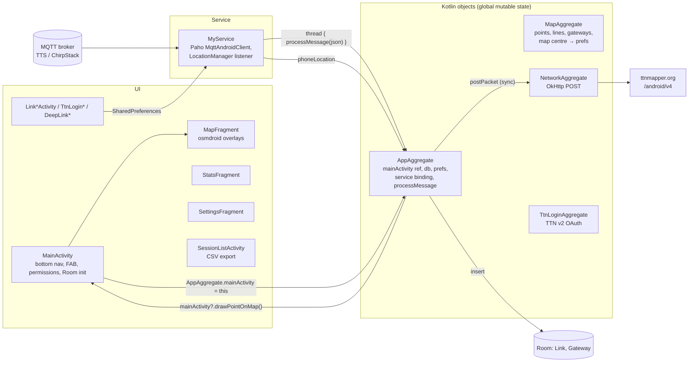

# 01 — Evaluation of TTN Mapper Android v3

Status: **Draft**

| Rev | Date | Author | Change |
|---|---|---|---|
| 0.1 | 2026-09-11 | R. Welling (with Claude) | First complete evaluation |

Related: [02 Requirements](02-requirements.md) (uses the `EVAL-nn` findings as
rationale), [license.md](../license.md), [ADR-0001](adr/ADR-0001-license.md).

---

## 1. Scope and method

**Object of evaluation.** `ttnmapper-android-v3`, the third rewrite of the TTN
Mapper "Phone Surveyor" app by JP Meijers, at commit `be325ba`
(2024-10-25, `versionName 2024.10.25`, `versionCode 36`), included in this
repository as a git submodule. This is the version that is on Google Play
(listing updated 2025-03-30).

**Method.** Static review of the complete hand-written source (58 Kotlin
files, 5,487 lines), the Android resources, manifest and Gradle build, the
Room schema files, the unit and instrumentation tests, and the git history
(102 commits, 2018-12 → 2024-10). The generated The Things Stack API models
(425 files, 41,118 lines under `model/ttnV3/models/`) were inspected for
role and size only. The public ttnmapper.org documentation and the
`ingress-api` repository were consulted for the server-side contract. The
app was **not** executed or profiled on a device for this evaluation;
statements about runtime behaviour are derived from the code and are marked
as such where it matters.

**Severity of findings.** *High* — prevents correct, safe or publishable
operation today; *Medium* — degrades reliability, maintainability or user
experience; *Low* — hygiene. Each finding ends with its consequence for the
remake (**Keep**, **Change**, **Drop**, **New**), which feeds the
requirements.

## 2. The application in brief

TTN Mapper is a *coverage surveyor*: a LoRaWAN node carried by the user
transmits periodically; the phone subscribes over MQTT to the node's uplink
stream on the network server, takes the reception metadata (which gateways
heard the packet, with which RSSI/SNR) and pairs it with the phone's GNSS
position. Every such measurement is drawn on a map, stored in a local
database and — by default — uploaded to ttnmapper.org, which aggregates the
community's measurements into the public coverage map.

Feature inventory as found:

| Area | Features |
|---|---|
| Linking a mapping device | Choice of network: The Things Stack v3 (host, `app@tenant`, API key, device id), ChirpStack (host, credentials, application id, device EUI); TTN v2 (form, OAuth login through a WebView, handler discovery, deep link `https://app.ttnmapper.org/?appid=…&accesskey=…`) — v2 UI is hidden but the code is present |
| Mapping session | Start/stop FAB; foreground service (type `location`) that owns the MQTT connection and the location listener; persistent notification with status text; "keep screen on" |
| Map | osmdroid map with OSM Mapnik (colour / greyscale / inverted "night"), Esri terrain and satellite; own-location arrow with accuracy circle; auto-centre with a "centre" FAB; measurement points coloured by signal level, Packet-Broker-only points as rings; gateway markers and reception lines ("LoRdrive mode"); ttnmapper.org coverage tile overlay |
| Statistics | Totals (packets, gateways seen, gateways mapped) and last packet (time, gateway ids, max RSSI/SNR, frequency, data rate) |
| Data | Room database (one row per gateway reception); session list with per-session export to CSV and delete; export all |
| Upload | POST of every geo-tagged measurement to `https://integrations.ttnmapper.org/android/v4/`; "experiment" flag with name; optional second POST to a custom server |
| Settings | Linked device (read-only MQTT fields), recorded data, upload, map, general (screen on, sound on packet, sound picker), about (bug report by e-mail with logcat dump, version) |

## 3. Metrics

| Metric | Value |
|---|---|
| Hand-written Kotlin | 58 files, 5,487 lines (incl. tests) |
| Generated TTS OpenAPI models | 425 files, 41,118 lines |
| Activities / fragments | 12 activities, 3 fragments |
| Largest classes | `MapFragment` 488, `AppAggregate` 480, `MainActivity` 415, `MyService` 392, `ObjectCopy` 392 lines |
| Tests | `TestJsonParsing.kt` (228 lines, recorded messages for TTN v2, TTS v3, ChirpStack v3), `MigrationTest.kt` (Room 1→2), 2 example tests |
| Android | `minSdk 21`, `targetSdk 34`, `compileSdk 34`, AGP 8.7.1, Kotlin 2.0.21, view binding, no Compose |
| Key dependencies | osmdroid 6.1.18, `com.github.hannesa2:paho.mqtt.android:4.3.beta5` (JitPack), Moshi 1.15.1 (+KSP codegen), OkHttp 4.12.0, Room 2.6.1, Material 1.12.0 |
| Licence | GPL-3.0 (LICENSE file only, no per-file headers) |
| Activity | Last functional change 2021-12; 2024 commits are SDK/Gradle updates; 16 open issues upstream |

## 4. Architecture as found

The structure is a classic "activity + service + global singletons" Android
app. The singletons are the glue: the service pushes messages into
`AppAggregate.processMessage`, which parses, enriches, stores, uploads and
finally calls back into `MainActivity` (held as a static reference) to draw.
There is no view model, no repository layer, no dependency injection and no
abstraction over Android APIs; the "domain" objects are the Moshi JSON
classes.

## 5. Findings

### 5.1 Architecture and code structure

| ID | Sev. | Finding | Evidence | Consequence |
|---|---|---|---|---|
| EVAL-01 | High | Business logic lives in global singletons that hold Android objects, including a strong static reference to the running activity (`AppAggregate.mainActivity`), the database, preferences and the bound service. Processing code calls UI methods directly. Nothing can run outside an Android process; nothing can be unit-tested without instrumentation. | `aggregates/AppAggregate.kt` (`mainActivity`, `db`, `sharedPref`, `processMessage()` → `mainActivity?.drawLineOnMap`), `ui/MainActivity.kt` (`AppAggregate.mainActivity = this`) | **Change** — the remake needs a platform-independent core with explicit ports (network, position, storage, upload, presentation). Root cause of the multi-platform requirement. |
| EVAL-02 | Med | No layering: JSON DTOs (Moshi-annotated) double as domain model and as upload payload; per-protocol mapping (`ObjectCopy`) is a 392-line companion object; a reflection-based `copyPropsFrom` helper (kotlin-reflect) is present. | `model/*`, `utils/ObjectCopy.kt`, `utils/CommonFunctions.kt` | **Change** — separate wire models (per protocol), domain model and upload contract. |
| EVAL-03 | Med | Dead features and dead code: TTN v2 is still the *default* network type (`PREF_NETWORK_SERVER` default `NS_TTN_V2`) although TTN v2 was shut down in December 2021; the v2 form, the OAuth login (`account.thethingsnetwork.org` in a WebView), handler discovery over cleartext `http://discovery.thethingsnetwork.org:8080`, the app/device pickers and the `app.ttnmapper.org` deep link (which carries the access key in the URL) are all unreachable or non-functional; `Permissions.kt` is empty, `AppConstants.FOO` is a placeholder, `StrictMode` import unused. | `res/xml/preferences.xml`, `ui/LinkTtnV2Activity.kt`, `ui/TtnLoginActivity.kt`, `aggregates/TtnLoginAggregate.kt`, `ui/DeepLinkConfigureActivity.kt`, `ui/IntentConfigureActivity.kt`, `AndroidManifest.xml` | **Drop** — no TTN v2, no OAuth-with-WebView, no discovery, no credential-bearing deep links. A *new* credential-free provisioning mechanism replaces the deep link (see requirements). |

### 5.2 Concurrency and lifecycle

| ID | Sev. | Finding | Evidence | Consequence |
|---|---|---|---|---|
| EVAL-04 | High | Every MQTT message spawns an unbounded raw thread that runs the whole pipeline: JSON parsing, Room insert, *synchronous* HTTP POST(s) and UI callbacks. Shared mutable state — `numberOfPacketsRx`, `seenGateways` (`HashMap`), `MapAggregate.pointList` / `lineList` (`ArrayList`) — is mutated from these threads while the UI thread iterates the same lists in `redrawMap()`. Consequences: possible `ConcurrentModificationException`, lost counter increments, out-of-order processing, and under bursty traffic a thread per packet each blocking on network I/O. | `services/MyService.kt` (`messageArrived` → `thread(start = true) { AppAggregate.processMessage(...) }`), `aggregates/AppAggregate.kt`, `aggregates/MapAggregate.kt`, `ui/MapFragment.kt` (`redrawMap`) | **Change** — single ordered processing pipeline with bounded queue; UI observes immutable snapshots; I/O off the pipeline. |
| EVAL-05 | Med | Deprecated or fragile concurrency primitives: `GlobalScope.launch` for database work in the session list, `AsyncTask` to build the foreground notification, `Handler()` without a `Looper` for status count-up loops, `startActivityForResult`, `ActivityManager.getRunningServices` to detect the own service. | `ui/SessionListActivity.kt`, `utils/Notifications.kt`, `services/MyService.kt`, `ui/SettingsFragment.kt`, `aggregates/AppAggregate.kt` | **Change** — coroutines with structured scopes; explicit service state instead of process inspection. |

### 5.3 Network server protocol support

| ID | Sev. | Finding | Evidence | Consequence |
|---|---|---|---|---|
| EVAL-06 | High | ChirpStack support targets the **v3** JSON (`applicationName`, `devEUI`, `rxInfo[].gatewayID`, `loRaSNR`, `txInfo.dr`). ChirpStack **v4** (2022) publishes `deviceInfo{applicationName, deviceName, devEui, tenantId…}`, `rxInfo[].gatewayId`, `snr`, `txInfo.modulation.lora{bandwidth, spreadingFactor, codeRate}`. A v4 event therefore fails to parse and is silently discarded (`"Chirp can't parse received json"`). The data-rate decoding hard-codes the EU868 DR table (`// Assume EU868`), wrong for every other region. Practically: **the app does not work with a current ChirpStack.** | `model/chirpstack/*.kt`, `utils/ObjectCopy.kt` (`ChirpStackUplinkToTtnMapperUplink`) | **Change** — ChirpStack v4 adapter using the modulation fields from the event; no regional DR tables; v3 optional legacy adapter at most. |
| EVAL-07 | Med | TTS v3 parsing depends on 425 generated OpenAPI model classes (41 k lines) for the ~25 fields used; ties parsing to Moshi + KSP, bloats the APK and the build, and makes protocol updates a regeneration exercise. LR-FHSS is only partly mapped (`TODO: grid step, code rate`); an absent `f_port` is mapped to `0`; `received_at` (network time) is used as the measurement time. | `model/ttnV3/models/**`, `utils/ObjectCopy.kt` (`ttnV3UplinkToTtnMapperUplink`) | **Change** — hand-written minimal, lenient wire model (ignore unknown keys) covering the used fields, with fixtures. |
| EVAL-08 | — | **Good:** Packet Broker handling is correct and non-trivial: the pseudo-gateway `packetbroker` is skipped; for forwarded receptions the forwarder's gateway id/EUI and `forwarder_tenant_id@forwarder_net_id` become the reception's `network_id`; legacy `ttnv2` maps to `thethingsnetwork.org`; the home network id is `NS_TTS_V3://{tenant}@{net_id}`; EUIs are derived from `eui-xxxxxxxxxxxxxxxx` ids. These conventions are what ttnmapper.org expects. | `utils/ObjectCopy.kt`, `utils/CommonFunctions.kt` (`toEuiString`, `toNetIdString`) | **Keep** verbatim (semantics), covered by tests. |
| EVAL-09 | Low | One device per configuration; topics are built as `v3/{app@tenant}/devices/{dev}/up` and `application/{app}/device/{eui}/event/up`; the raw topic can be edited only in a disabled preference. No wildcard subscription, no device filter, no second device. | `ui/LinkTtsV3Activity.kt`, `ui/LinkChirpActivity.kt`, `res/xml/preferences.xml` | **Change** — profiles with one or more devices; optional wildcard with filter. |

### 5.4 MQTT connectivity and security

| ID | Sev. | Finding | Evidence | Consequence |
|---|---|---|---|---|
| EVAL-10 | High | **TLS is impossible.** `sanitiseMqttUri()` strips `mqtts://` and `mqtt://` and forces `tcp://`; no port is added, so Paho connects to 1883 in cleartext. API keys and passwords travel unencrypted. `network_security_config.xml` explicitly whitelists cleartext to `thethings.network` and the discovery host. | `utils/CommonFunctions.kt` (`sanitiseMqttUri`), `res/xml/network_security_config.xml`, `ui/MainActivity.kt` (`onSharedPreferenceChanged`) | **Change** — TLS by default (TTS: 8883), certificate validation, plaintext only after explicit acknowledgement. |
| EVAL-11 | High | **Secrets are logged.** `connect()` logs `"Using MQTT password: …"` at error level; the "Email & Copy Log Output" function dumps the last 100 kB of `logcat -d` into an e-mail *and* the clipboard — password included. | `services/MyService.kt` (`connect`), `ui/SettingsFragment.kt` (`bugreport`) | **Change** — no secrets in logs, redaction in diagnostics bundles. |
| EVAL-12 | Med | Credentials are stored in plain `SharedPreferences` (generic `PREF_MQTT_PASSWORD` plus per-network copies) and echoed as preference summaries in the settings screen. `allowBackup="false"` at least keeps them out of cloud backups. | `ui/Link*Activity.kt`, `ui/SettingsFragment.kt`, `AndroidManifest.xml` | **Change** — platform secure storage, masked display. |
| EVAL-13 | Med | The upstream repository contains the release keystore (`keystore.jks`) and the signing configuration with the store and key passwords in `app/build.gradle` (`storePassword 'ttnmapper'`, absolute path in the developer's home). | `app/build.gradle` (`signingConfigs`), repository root | Upstream concern, not a remake defect. **Lesson** — signing material and secrets never enter this repository (`.gitignore`, CI secrets). |
| EVAL-14 | Med | MQTT client is a community fork of the abandoned Paho Android service (`hannesa2:paho.mqtt.android:4.3.beta5`, a beta from JitPack). Settings: auto-reconnect, clean session, QoS 0, default keep-alive. Any failure during the first connect or subscribe **stops the whole service** (`selfStop = true; AppAggregate.stopService()`), so a transient broker or network problem at start ends the session with a dialog; after a mid-session loss the app relies on Paho's opaque reconnect. Auth failures are recognised by reason code and explained. | `services/MyService.kt` (`connect`, `subscribeToTopic`, `connectionLost`) | **Change** — maintained client, explicit reconnect state machine with backoff that never gives up while a session is active; only credential errors are fatal and are reported as such. |

### 5.5 Positioning

| ID | Sev. | Finding | Evidence | Consequence |
|---|---|---|---|---|
| EVAL-15 | Med | `LocationManager` is registered for both the GPS and the NETWORK provider at maximum rate; every fix, from either provider, overwrites the single `AppAggregate.phoneLocation`. A coarse network fix (hundreds of metres) arriving after a good GPS fix is used for the next packet. Accuracy is recorded, so ttnmapper.org can filter, but the local map and export contain the coarse point. `satellites` and `hdop` fields exist in the model but are never populated. The 10-second staleness check before geo-tagging is good practice. | `services/MyService.kt` (`startLocationTracking`, `locationListener`), `aggregates/AppAggregate.kt` (`processMessage`) | **Change** — accuracy/provider gating; fill satellites/HDOP where available; keep the freshness rule (configurable). |
| EVAL-16 | Low | GNSS status is a text line refreshed by 1-second handler loops ("GPS accuracy low (>10m)", "location too old"); no numeric accuracy, satellite count or age at a glance. | `services/MyService.kt` (`setGPSCountupStatus`) | **Change** — structured status indicator. |

### 5.6 Measurement processing rules

| ID | Sev. | Finding | Evidence | Consequence |
|---|---|---|---|---|
| EVAL-17 | — | **Good — the rules are right and match ttnmapper.org:** signal *level* = RSSI + SNR when SNR < 0; colour thresholds > −100 red, > −105 orange, > −110 yellow, > −115 green, > −120 cyan, > −140 blue, else/unknown black (semi-transparent); point colour is the best level over all receptions; gateway locations are validated (null island `|lat|<1 ∧ |lon|<1`, `|lat|>90`, `|lon|>180`); a measurement is stored even without a position but neither drawn nor uploaded without a fresh one; experiment name defaults to `experiment_<installation-id>`; the user agent is `Android<release> App<code>:<name>`; a random installation UUID is created at first run. | `utils/CommonFunctions.kt` (`getColorForSignal`), `aggregates/AppAggregate.kt` (`processMessage`, `isGatewayLocationValid`), `ui/MainActivity.kt` (`onCreate`) | **Keep** — these are requirements of the remake, with tests. |

### 5.7 Map and rendering

| ID | Sev. | Finding | Evidence | Consequence |
|---|---|---|---|---|
| EVAL-18 | Med | One overlay object per drawn item: each measurement becomes a `SimpleFastPointOverlay` containing a single point, each reception line a `Polyline`. Overlay count grows linearly with the session; `redrawMap()` clears and recreates all overlays on every fragment (re)creation. Long drives degrade rendering (inferred from the code, not measured). | `ui/MapFragment.kt` (`drawPointOnMap`, `drawLineOnMap`, `redrawMap`) | **Change** — layer-based renderer with batched geometry. |
| EVAL-19 | Med | Tile sources: OSM tile servers are called directly with osmdroid's default User-Agent (the OSMF tile usage policy requires an identifying UA and limits use); Esri World Imagery / Shaded Relief are used without attribution or terms check; **no OSM attribution is shown on the map** (osmdroid's `CopyrightOverlay` is not added — ODbL/OSMF require it). The ttnmapper.org coverage overlay is hard-coded to network `NS_TTS_V3://ttn@000013` regardless of the linked network. Map centre/zoom are written to preferences on every scroll event. | `ui/MapFragment.kt` (`onCreate`, `onCreateView`), `aggregates/MapAggregate.kt` | **Change** — identifying UA, attribution, tile cache, configurable sources whose terms the user accepts, coverage overlay following the active network id. |
| EVAL-20 | Low | The own-location marker uses osmdroid's `GpsMyLocationProvider` (a second GNSS consumer) independent of the service's listener, so the marker and the recorded position can differ. | `ui/MapFragment.kt` (`redrawMap`) | **Change** — one position source feeds both. |

### 5.8 Storage, sessions and export

| ID | Sev. | Finding | Evidence | Consequence |
|---|---|---|---|---|
| EVAL-21 | Med | Data model is sound: Room v2 with `Link` (one row per gateway reception, 41 columns, indexed by session) and `Gateway`; sessions are keyed by the ISO-8601 start time; migration 1→2 is implemented and tested. The **CSV export is defective**: the last column is skipped (`for (i in 0 until columnCount - 1)`), the header keeps a trailing comma (the result of `dropLast(1)` is discarded), values are neither quoted nor escaped, the whole file is concatenated in a `String` in memory, the MIME type is `text/plain`, and the export runs on the UI thread. | `room/*.kt`, `ui/SessionListActivity.kt` (`writeFileContent`) | **Keep** the per-reception data model and column semantics (for compatibility of exports); **Change** the exporter (correct, streamed, RFC 4180, GeoJSON added). |
| EVAL-22 | Low | The `Gateway` table was once filled from ttnmapper.org's `gwdetails` API; the insert is now commented out, the table is only cleared. `NetworkAggregate.getGatewayFromTtnMapper()` is unused. | `aggregates/AppAggregate.kt`, `aggregates/NetworkAggregate.kt`, `room/Gateway.kt` | **Change** — gateway registry built from receptions, optional enrichment from ttnmapper.org. |

### 5.9 Upload

| ID | Sev. | Finding | Evidence | Consequence |
|---|---|---|---|---|
| EVAL-23 | High | Uploads are synchronous `OkHttp` calls inside the per-message thread. A failure (no network, timeout, 5xx) is logged and the measurement is **lost for ttnmapper.org** — there is no queue, no retry, no offline buffering. The server's `{"success": false, "message": …}` is parsed but the message is discarded (commented out). The custom-server POST repeats the same flow. | `aggregates/NetworkAggregate.kt` (`postPacket`), `aggregates/AppAggregate.kt` | **Change** — persistent store-then-forward queue with retry and visible state; server messages surfaced. |
| EVAL-24 | — | **Good — the upload contract is the de-facto phone API of ttnmapper.org** and must be kept byte-compatible: `POST https://integrations.ttnmapper.org/android/v4/` with the JSON of `TtnMapperUplinkMessage` / `TtnMapperGateway` (snake_case keys, times in nanoseconds since epoch, frequency and bandwidth in Hz, `gateways[]` per reception, `experiment`, `userid`, `useragent`), response `{"success": bool, "message": string}`. Server-side `CheckData`/`SanitizeData` validation is applied to non-experiment packets (ingress-api `android.go`). | `model/TtnMapperUplinkMessage.kt`, `model/TtnMapperGateway.kt`, `res/values/configuration_constants.xml`, ingress-api repository | **Keep** — specified field by field in the FDS; new user agent to be agreed with the TTN Mapper maintainer. |

### 5.10 User experience and UI

| ID | Sev. | Finding | Evidence | Consequence |
|---|---|---|---|---|
| EVAL-25 | Med | No onboarding: linking a device is a preference entry under *Settings*; upload to ttnmapper.org is on by default without an explicit consent step; permissions are requested when the FAB is pressed, with a rationale only for the battery-optimisation exemption. Fragments are replaced (and rebuilt) on every bottom-navigation tap. Errors from background code surface as `AlertDialog`/`Toast` through the static activity reference. Status texts are drawn over the map without background. All strings are hard-coded in layouts and code (English only, not localisable). No dark theme apart from the inverted map, no landscape/tablet layout, no accessibility labels. The stats screen is a static two-column list. | `ui/*`, `res/layout/*`, `res/xml/preferences.xml`, `res/values/strings.xml` (7 strings) | **Change** — onboarding with consent and permission rationale; state-driven UI; responsive layouts; theming; localisation; accessibility. |
| EVAL-26 | Low | The network selection screen carries Patreon/PayPal donation buttons for the TTN Mapper project; branded TTN/TTS/ChirpStack logos are shipped as drawables. | `ui/LinkSelectNetworkActivity.kt`, `res/drawable/ic_*_logo.xml` | **Drop** (donation buttons belong to the original project); no third-party logos in the remake. |

### 5.11 Platform compliance (Android / Google Play)

| ID | Sev. | Finding | Evidence | Consequence |
|---|---|---|---|---|
| EVAL-27 | High | `targetSdkVersion 34`: Google Play has required API 35 for updates since 31 Aug 2025 and requires API 36 from 31 Aug 2026 — the app cannot be updated on Play as is. `com.google.android.gms.permission.AD_ID` is declared without any advertising use (a Data-Safety liability). The foreground service is started with `startService()`, and `startForeground()` is called later from an `AsyncTask` after binding — fragile against the 5-second foreground rule and impossible from the background on Android 12+. The battery-optimisation exemption is requested with `ACTION_REQUEST_IGNORE_BATTERY_OPTIMIZATIONS`, which Play policy restricts to core-function cases. Positive: service type `location`, `FOREGROUND_SERVICE_LOCATION` and `POST_NOTIFICATIONS` are declared; `exported` flags are set. | `app/build.gradle`, `AndroidManifest.xml`, `aggregates/AppAggregate.kt`, `utils/Notifications.kt`, `ui/MainActivity.kt` (`setupPermissions`) | **Change** — target current API, minimal permissions, correct foreground-service start, policy-conformant background justification. |

### 5.12 Build, dependencies and repository hygiene

| ID | Sev. | Finding | Evidence | Consequence |
|---|---|---|---|---|
| EVAL-28 | Med | Groovy Gradle with both `kotlin-kapt` and `ksp` applied; `kotlin-stdlib-jdk7`; `androidx.legacy:legacy-support-v4`; Jetifier enabled; `fileTree(libs)`; `minifyEnabled false` although Moshi codegen was adopted *because* reflection broke under R8; MQTT client from JitPack; no lint/format configuration; no CI. | `build.gradle`, `app/build.gradle`, `gradle.properties`, git history (`b85b3b6`) | **New** — Kotlin DSL, version catalogue, static analysis, CI from day one, pinned and licence-checked dependencies. |
| EVAL-29 | Low | Upstream README is five lines; issues (16 open) include help-wanted items; the `.idea` folder is committed. | repository | **New** — documentation as a deliverable (this design set, user docs). |

### 5.13 Testing

| ID | Sev. | Finding | Evidence | Consequence |
|---|---|---|---|---|
| EVAL-30 | Med | Automated tests cover JSON parsing of the three protocols with recorded messages (valuable fixtures: a TTN v2 message, TTS v3 messages including Packet Broker metadata, a ChirpStack v3 event) and the Room migration. Nothing covers the processing rules, colour scale, gateway validation, CSV export, upload payload or connection handling; no UI tests. | `app/src/test/…/TestJsonParsing.kt`, `app/src/androidTest/…/MigrationTest.kt` | **Keep** the fixtures (GPL, re-used with attribution); **New** — rule and pipeline tests, replay-based integration tests. |

### 5.14 Licensing, branding and third-party terms

| ID | Sev. | Finding | Evidence | Consequence |
|---|---|---|---|---|
| EVAL-31 | — | Licence is GPL-3.0 (LICENSE file, no per-file notices, no "or later" grant). Dependencies are GPL-compatible (Apache-2.0; Paho EPL-2.0/EDL). Third-party logos are shipped (trademark exposure for a fork). OSM attribution is missing (see EVAL-19). "TTN Mapper" is the identity of the upstream project and ttnmapper.org. | `LICENSE`, `res/drawable/*`, `ui/MapFragment.kt` | **Constraint** — the remake is GPL-3.0-only ([ADR-0001](adr/ADR-0001-license.md)), uses its own name and no third-party logos, shows map attribution. |

## 6. Feature disposition

| Feature of TTN Mapper v3 | Disposition | Note |
|---|---|---|
| Link The Things Stack v3 device | **Keep / Change** | TLS default, tenant guidance, test connection, several devices |
| Link ChirpStack device | **Change** | ChirpStack v4 JSON; v3 at most as legacy adapter |
| TTN v2 form, OAuth login, handler discovery, credential deep link | **Drop** | Network gone since 2021; deep link carried secrets |
| Start/stop with one control, foreground operation | **Keep** | Correct foreground-service start, notification with actions |
| Map: OSM base maps, greyscale, night | **Keep / Change** | Attribution, identifying UA, cache, configurable XYZ source |
| Map: Esri terrain / satellite | **Change** | Only as user-configured source with accepted terms |
| ttnmapper.org coverage overlay | **Keep / Change** | Follows the active network id, opacity control |
| LoRdrive lines, gateway markers, coloured points, PB rings | **Keep** | Batched layer rendering |
| Auto-centre + centre FAB, own position arrow | **Keep** | Single position source |
| Stats screen | **Keep / Change** | Live indicators, session statistics, per-gateway table, big-number drive view |
| Session list, delete, CSV export | **Keep / Change** | Correct CSV, GeoJSON, streamed, share sheet |
| Upload to ttnmapper.org, experiment flag/name | **Keep / Change** | Consent, persistent queue with retry, server messages visible |
| Custom server POST | **Keep** | With optional auth header |
| Sound on packet, sound picker | **Keep** | Plus optional alerts |
| Keep screen on | **Keep** | |
| Bug report by e-mail with logcat | **Change** | Redacted diagnostics bundle |
| Version in About | **Keep** | Plus licences / third-party notices |
| Donation buttons, third-party logos | **Drop** | |
| — | **New** | Desktop and Raspberry Pi shells, GNSS via gpsd/serial, Android Auto, profiles, offline queue, onboarding with consent, secure secret storage, dark/light themes, localisation, diagnostics, replay/simulator tool, CI and tests |

## 7. What is carried over from the original

Carried over as *semantics* (re-implemented in the remake, with tests, under
the same GPL-3.0 licence):

- The measurement model: one uplink, many receptions; the column set of the
  `Link` table as the baseline for exports.
- The processing rules of EVAL-17 (level, colour scale, best-level point,
  gateway location validation, storage-without-position, experiment naming,
  installation id).
- The Packet Broker and network-id conventions of EVAL-08.
- The upload contract of EVAL-24, field by field.
- The recorded protocol messages of `TestJsonParsing.kt` as test fixtures,
  complemented by ChirpStack v4 and current TTS messages.
- The UI concept: map first, status at a glance, start/stop as the single
  primary action, statistics and sessions one tap away.

Not carried over: any Android-specific structure (activities, singletons,
service wiring), the generated TTS models, the osmdroid overlay code, the
Paho Android service, the TTN v2 code paths.

## 8. Conclusions

1. The original app is small, focused and — for The Things Stack v3 — still
   functionally correct. Its domain rules and its upload contract are the
   valuable core and are adopted unchanged.
2. It is not maintainable as a multi-platform code base: the logic is fused
   to Android singletons (EVAL-01, EVAL-04). A remake with a
   platform-independent core is the only way to reach Linux, Raspberry Pi
   and the car, and it is also what makes the code testable.
3. Three defects would have to be fixed even for an Android-only successor:
   cleartext MQTT (EVAL-10), secrets in logs and bug reports (EVAL-11) and
   lost uploads (EVAL-23). Together with the outdated target SDK (EVAL-27)
   and the ChirpStack v3-only support (EVAL-06) they define the minimum bar
   for the remake.
4. The requirements in [02-requirements.md](02-requirements.md) reference
   these findings as their rationale; the traceability table in its appendix
   shows that every finding with a **Change**, **Drop** or **New**
   disposition is covered.
