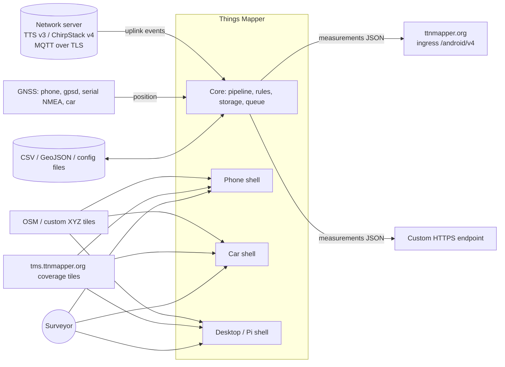

# 02 — Requirements and targets

Status: **Draft**

| Rev | Date | Author | Change |
|---|---|---|---|
| 0.1 | 2026-09-11 | R. Welling (with Claude) | First complete set, derived from the evaluation |
| 0.2 | 2026-10-24 | R. Welling (with Claude) | Project renamed to Things Mapper; editions and monetisation (ADR-0007): Free with ads, Paid without ads, Android Auto Paid-only; new §6.16, REQ-P-009, REQ-NF-063/064, REQ-C-010, TGT-09, OP-7…OP-10 |
| 0.3 | 2026-10-24 | R. Welling (with Claude) | OP-7 decided (sponsor catalogue only), OP-8 decided (route L-A, additional permission in license.md); REQ-F-155 withdrawn, REQ-F-159 changed |
| 0.4 | 2026-10-24 | R. Welling (with Claude) | Free start screen (REQ-F-162); §6.17 cost awareness and voluntary support (REQ-F-163…167, ADR-0008); Paid price €6; REQ-C-011 payment rules; OP-11 Apple investment; hobby non-goal; doc 08 |
| 0.5 | 2026-10-25 | R. Welling (with Claude) | REQ-C-008: packages must install on the oldest and newest supported release |

Related: [01 Evaluation](01-evaluation.md) (rationale `EVAL-nn`),
[03 FDS](03-fds.md), [05 TDS](05-tds.md), [06 Test plan](06-test-plan.md),
[ADR-0002 stack](adr/ADR-0002-technology-stack.md),
[ADR-0004 car platform](adr/ADR-0004-car-platform.md),
[ADR-0007 editions](adr/ADR-0007-editions-and-monetisation.md),
[ADR-0008 cost awareness](adr/ADR-0008-cost-awareness-and-support.md),
[08 Costs and funding](08-costs-and-funding.md).

Conventions: see [README](README.md#conventions). *shall* = mandatory,
*should* = expected, *may* = optional; priority M/S/C/W (MoSCoW).

---

## 1. Introduction

### 1.1 Purpose

This document defines *what* Things Mapper has to do and how well, for all
target platforms, as the agreed basis for the functional design (FDS), the
GUI design, the technical design (TDS), the test plan and the implementation
plan. It is the single place where scope is decided.

### 1.2 Product vision

> Things Mapper turns a LoRaWAN mapping device plus any device with a GNSS
> receiver — a phone, a car display, a Raspberry Pi behind the windscreen —
> into a coverage surveyor that shows the network as it is heard, keeps every
> measurement safe, and contributes it to the community map when the user
> says so.

### 1.3 Relationship to TTN Mapper

Things Mapper is a remake of the TTN Mapper Android app (GPL-3.0) and a
*client* of the TTN Mapper platform: it uploads measurements to the
ttnmapper.org ingress API in the format that platform expects and shows the
platform's coverage tiles. It does not replace any server-side component and
does not change the semantics of the data it contributes.

### 1.4 Definitions

See the glossary in [README](README.md#glossary-short). "Level" is RSSI plus
SNR when SNR is negative; "measurement" is one uplink with position and all
its receptions; "profile" is the stored connection configuration for one
mapping device on one network server.

## 2. Stakeholders and users

| Stakeholder | Interest | Representative needs |
|---|---|---|
| **Walker / cyclist surveyor** (phone) | Map coverage while moving on foot or bike; phone in pocket | Works with the screen off, low battery use, glanceable status, sound cue |
| **Driver / passenger** (phone in a holder, Android Auto, Raspberry Pi box) | Map while driving, minimal attention | Big numbers, dark theme at night, no text entry while moving, auto-start, one-button operation |
| **Community mapper** (The Things Network) | Contribute valid data to ttnmapper.org | Correct upload format, experiment mode, no data loss offline |
| **Private network operator** (ChirpStack v4, private TTS tenant) | Survey own network, keep data local | ChirpStack v4 support, TLS, per-profile upload opt-out, complete exports |
| **Fixed-installation builder** (Raspberry Pi + touch display + GNSS) | Dedicated device without keyboard | Kiosk mode, config file provisioning, gpsd/serial GNSS, resilience to power/network loss |
| **Maintainer / contributor** | Sustainable, testable code base | Layered architecture, tests, CI, one core for all platforms, room for iOS |
| **Maintainer as publisher** (hobby, not a living) | Cover the money costs of development and publication — store accounts, Android and Apple test hardware, Android Auto bench, Raspberry Pi kit (doc 08) — and make users aware of them | Free edition with sponsor banners and a start screen, Paid edition (€6 once) without both and with Android Auto, cost page, yearly thank-you card, voluntary support; no paid services (ADR-0007, ADR-0008) |
| **TTN Mapper platform (JP Meijers)** — external | Data quality and server load | Contract compliance, identifying user agent, retry discipline |
| **Map data providers** (OpenStreetMap, ttnmapper.org tiles) — external | Fair use | Attribution, caching, identifying user agent |

## 3. System context

External interfaces (detailed in the FDS): MQTT uplink streams of The Things
Stack v3 and ChirpStack v4; GNSS sources; the ttnmapper.org ingress API
(`POST /android/v4`); optional custom HTTPS endpoint; raster tile servers
(XYZ) and the ttnmapper.org coverage TMS; local files for export, import and
provisioning.

## 4. Scope

### 4.1 In scope (this design)

- Mapping client for LoRaWAN uplink metadata from The Things Stack v3 and
  ChirpStack v4 over MQTT.
- Positioning from the platform GNSS (Android), gpsd or serial NMEA (Linux),
  replay files (development), manual fixed position (tests).
- Live map, indicators and statistics; local storage; export; upload to
  ttnmapper.org and to a custom endpoint.
- Shells: Android phone/tablet, Android Auto, Linux desktop, Raspberry Pi
  touch kiosk.
- Developer tooling to replay recorded sessions.

### 4.2 Out of scope (this design)

| Item | Reason |
|---|---|
| iOS shell | Deferred to phase 4; architecture keeps it possible (REQ-P-005); its editions are specified now (REQ-P-009) |
| Feature unlocks, paid features, commercial support or services | Hobby project: the editions differ only in ads, the start screen and Android Auto (§6.16); voluntary support (§6.17) unlocks nothing; no paid support, consultancy or custom builds (ADR-0008 D6) |
| TTN v2, Helium, other network servers | TTN v2 is gone; others via the adapter extension point later |
| Downlinks, device configuration, payload decoding | Not needed for coverage mapping |
| Server-side components, own coverage backend | Things Mapper is a client of ttnmapper.org |
| User accounts, cloud sync between devices | Privacy and complexity; exports cover the need |
| Android Automotive OS build | Decided for Android Auto first ([ADR-0004](adr/ADR-0004-car-platform.md)); the car module is written so an AAOS build is a packaging task |

## 5. Platform requirements (REQ-P)

| ID | Requirement | Prio | Rationale / source |
|---|---|---|---|
| REQ-P-001 | The Android application shall support Android 8.0 (API 26) and newer, target the API level required by Google Play at release (36 from 31 Aug 2026), and ship `arm64-v8a` and `x86_64` (emulator) ABIs; `armeabi-v7a` may be added. | M | EVAL-27; Play policy |
| REQ-P-002 | The Android Auto experience shall be built with the Android for Cars App Library (Car App API level 7 or higher) and run on current Android Auto hosts via projection from the phone. It is part of the Paid edition only (REQ-F-160). | M (phase 3) | ADR-0004, ADR-0007 |
| REQ-P-003 | The Linux desktop application shall run on x86-64 Debian 12 / Ubuntu 22.04 or newer (X11 or Wayland via XWayland) with a bundled Java runtime and be distributed as a `.deb` package. | M | Stakeholder "maintainer", development platform |
| REQ-P-004 | The Raspberry Pi build shall run on Raspberry Pi 4 (≥ 2 GB) and 5 with 64-bit Raspberry Pi OS (Bookworm or newer) on the official 7" touch display (800×480 landscape) and the Touch Display 2 (720×1280, portrait or rotated), with GNSS via gpsd or a serial/USB NMEA receiver, distributed as an arm64 `.deb` with kiosk autostart. | M | Stakeholder "fixed-installation builder" |
| REQ-P-005 | The core, data, network, map and UI modules shall contain no JVM-only or Android-only API in common code so that an iOS shell can be added later; where a macOS CI runner is available the core shall be compiled for `iosArm64` to prove it. | S | Vision; ADR-0002 |
| REQ-P-006 | Layouts shall adapt from 360×640 dp portrait (phone) through 800×480 and 720×1280 (Pi displays) to ≥ 1024×600 (tablet, desktop) and to the car host's template canvas. | M | GUI design |
| REQ-P-007 | Input shall work with touch alone (phone, Pi), with mouse and keyboard (desktop) and with the car host's rotary/touch controls through templates. | M | |
| REQ-P-008 | The Android application shall provide its core functionality without Google Play Services; Play-Services-dependent extras (if any) shall be isolated in a build flavour. | S | REQ-C-003, F-Droid distribution |
| REQ-P-009 | When the iOS shell is built (phase 4) it shall be published as a Free edition with advertisements and a Paid edition without, functionally identical and following REQ-F-150…159 (iOS has no car feature in scope; a future CarPlay feature would be Paid-only like Android Auto). | M (phase 4) | ADR-0007 |

## 6. Functional requirements (REQ-F)

### 6.1 Profiles and network linking

| ID | Requirement | Prio | Rationale |
|---|---|---|---|
| REQ-F-001 | The user shall be able to create, edit, duplicate and delete connection **profiles**; each profile has a name, a network server type and the type-specific settings. | M | EVAL-09 |
| REQ-F-002 | A **The Things Stack v3** profile shall capture: server host (cluster presets `eu1`, `nam1`, `au1` of The Things Stack Cloud/Sandbox and free text for private deployments), application id, tenant id (default `ttn` for The Things Network; empty for single-tenant Open Source), API key, one or more device ids, TLS on/off (default on, port 8883; plain 1883 only after acknowledgement). The subscribe topic `v3/{app}@{tenant}/devices/{device}/up` is derived, and editable for expert use. | M | EVAL-08, EVAL-10; TTS docs |
| REQ-F-003 | A **ChirpStack v4** profile shall capture: broker host and port, TLS on/off (default on), optional username/password, application id (UUID), one or more device EUIs, optional topic prefix. The subscribe topic `application/{applicationId}/device/{devEui}/event/up` is derived and editable. | M | EVAL-06 |
| REQ-F-004 | The user shall be able to **test a profile** before saving: connect, authenticate, subscribe, and report the outcome distinctly (DNS/TCP failure, TLS failure, authentication refused, subscribed but no message within a wait time, message received and parsed). | S | EVAL-14 |
| REQ-F-005 | A profile shall support **several devices**; the system subscribes per device or to the application wildcard (`+`) and filters on the configured devices. | S | EVAL-09 |
| REQ-F-006 | Profiles shall be importable and exportable as JSON files without secrets, and — on Android — importable by scanning a QR code with the same content; the secret is entered separately. | S | EVAL-03 (replaces the credential deep link), kiosk provisioning |
| REQ-F-007 | Exactly one profile is **active**; changing the active profile while mapping stops the session first. | M | |
| REQ-F-008 | Adding support for a further network server shall require a new protocol adapter and its profile form only; pipeline, storage, map and upload shall not change. | S | REQ-NF-043 |
| REQ-F-009 | TTN v2, OAuth login via embedded web views, handler discovery and credential-bearing deep links are **not** supported. | W | EVAL-03 |

### 6.2 Session control and background operation

| ID | Requirement | Prio | Rationale |
|---|---|---|---|
| REQ-F-010 | Mapping shall start and stop with **one action** on the main screen; the mapping state shall be visible at all times on every screen. | M | EVAL-17 concept kept |
| REQ-F-011 | While mapping, the system shall keep the network connection and the position source running when the screen is off or the application is in the background — on Android through a foreground service of type `location` with a persistent notification; on desktop and Pi as a long-running process. | M | EVAL-27 |
| REQ-F-012 | Every start shall create a **session** with start time, active profile and platform; stop records the end time; sessions collect their measurements. | M | EVAL-21 |
| REQ-F-013 | On the Raspberry Pi kiosk the system should optionally start mapping automatically at boot and resume after a crash or power loss. | S | Stakeholder "fixed-installation builder" |
| REQ-F-014 | The Android notification should show live status (link, GNSS, packets, age of the last packet) and offer a *Stop* action. | S | EVAL-25 |
| REQ-F-015 | A *keep screen on while mapping* option shall exist (default on for phones). | M | Kept feature |

### 6.3 Ingest and protocol adapters

| ID | Requirement | Prio | Rationale |
|---|---|---|---|
| REQ-F-020 | The system shall subscribe to the uplink topics of the active profile over MQTT 3.1.1 (QoS 0, clean session) and parse TTS v3 `ApplicationUp` messages and ChirpStack v4 `UplinkEvent` messages. | M | EVAL-06, EVAL-07; TTS supports QoS 0 only |
| REQ-F-021 | The adapters shall extract the fields listed in FDS §3.2 (device identifiers; time; FPort; FCnt; frequency; modulation with bandwidth/spreading factor or bit rate; coding rate; per reception: gateway id, EUI, antenna, time, timestamp, fine timestamps, channel, RSSI, signal RSSI, SNR, gateway location with accuracy and source, Packet Broker forwarder metadata). | M | EVAL-08, EVAL-24 |
| REQ-F-022 | Unknown JSON members shall be ignored; missing optional members tolerated; a message that cannot be parsed shall be counted, logged without secrets and skipped — the session continues. | M | EVAL-06 (silent failure), EVAL-11 |
| REQ-F-023 | **Packet Broker** receptions shall be handled as TTN Mapper does: the pseudo-gateway `packetbroker` is not a reception; forwarded receptions use the forwarder's gateway id/EUI and `forwarder_tenant_id@forwarder_net_id` as their network id (`ttnv2` → `thethingsnetwork.org`); a measurement whose receptions are all forwarded is marked *PB-only*. | M | EVAL-08 |
| REQ-F-024 | The measurement's network id shall be `NS_TTS_V3://{tenant}@{net_id}` for TTS; for ChirpStack v4 the convention of ttnmapper.org's `chirp/v4` integration shall be used (open point OP-2). | M | EVAL-08 |
| REQ-F-025 | On connection loss the system shall reconnect automatically with exponential backoff (1 s … 60 s, jittered) for as long as a session is active; the reconnect state shall be visible. Only authentication and authorisation failures are terminal, and they are explained to the user. | M | EVAL-14 |
| REQ-F-026 | Duplicate uplinks (same device and frame counter within 30 s) should be merged into one measurement. | C | Robustness |
| REQ-F-027 | MQTT 5 may be used where the broker offers it; TLS shall be the default (REQ-NF-020). | C / M | EVAL-10 |
| REQ-F-028 | A *generic MQTT/JSON* adapter with user-supplied JSON paths may be provided for network servers not natively supported. | C | REQ-F-008 |

### 6.4 Positioning

| ID | Requirement | Prio | Rationale |
|---|---|---|---|
| REQ-F-030 | Position sources: Android platform GNSS (GPS provider, with accuracy, altitude, speed, bearing and — where available — satellite count); on Linux/Pi gpsd (TCP JSON) and serial/USB NMEA; on all platforms a manual fixed position and a replay file for testing. Android may additionally offer the fused provider on builds with Play Services. | M | EVAL-15, REQ-P-004 |
| REQ-F-031 | A measurement shall be geo-tagged only with a fix younger than the **freshness window** (default 10 s, configurable 5–30 s); otherwise it is stored as *no position* and neither drawn nor uploaded. | M | EVAL-17 |
| REQ-F-032 | Each position shall record latitude, longitude, altitude, horizontal accuracy (m), HDOP and satellites when provided, fix time, speed and bearing when provided, and a source label (`gps`, `fused`, `network`, `gpsd`, `nmea`, `car`, `manual`, `replay`). | M | EVAL-15, ingress fields |
| REQ-F-033 | A fresh precise fix shall never be replaced by a coarser one: sources are prioritised and a fix with worse accuracy is accepted only when the better fix has expired. | M | EVAL-15 |
| REQ-F-034 | A **GNSS indicator** shall show fix state, accuracy, satellites (if known) and fix age, and warn when accuracy exceeds 10 m (ttnmapper.org's threshold) or the fix is stale. | M | EVAL-16; ttnmapper.org FAQ |
| REQ-F-035 | Speed and bearing should be stored per measurement for local analysis (not uploaded unless the ingress contract has fields for them). | S | |
| REQ-F-036 | The system may suggest enabling *experiment* mode when altitude or speed indicate a non-standard survey (e.g. > 200 km/h, or altitude far above the surrounding terrain). | C | ttnmapper.org FAQ |

### 6.5 Measurement processing rules

| ID | Requirement | Prio | Rationale |
|---|---|---|---|
| REQ-F-040 | Signal **level** and the colour scale shall be identical to TTN Mapper's: level = RSSI + min(SNR, 0); > −100 dBm red, > −105 orange, > −110 yellow, > −115 green, > −120 cyan, > −140 blue, otherwise/unknown black. | M | EVAL-17 |
| REQ-F-041 | A measurement's colour is the best level over its receptions; PB-only measurements are drawn as rings. | M | EVAL-17 |
| REQ-F-042 | Gateway locations shall be validated (null island `\|lat\| < 1 ∧ \|lon\| < 1`, `\|lat\| > 90`, `\|lon\| > 180`); invalid locations produce no marker and no line but are kept in the data. | M | EVAL-17 |
| REQ-F-043 | The system shall maintain a **gateway registry** (per session and overall): id, EUI, network id, location and source, description, first/last seen, reception count, best level. | M | EVAL-22 |
| REQ-F-044 | Every successfully parsed uplink shall be stored, with or without position (flagged). | M | EVAL-17 |
| REQ-F-045 | Processing shall be **ordered and lossless**: messages are processed in arrival order through a bounded queue; bursts of at least 10 messages/s for 60 s shall not lose messages; queue depth is a diagnostic metric. | M | EVAL-04 |
| REQ-F-046 | **Experiment** mode is a per-session setting (flag and name, default `experiment_<installation-id>`) applied to stored and uploaded data. | M | EVAL-17 |
| REQ-F-047 | Units and formats: frequency and bandwidth in Hz, times in UTC nanoseconds since epoch, EUIs as 16 upper-case hex characters, gateway ids as delivered (lower-case `eui-…` form kept), coding rate as delivered (`4/5`, `CR_4_5` normalised to `4/5`). | M | EVAL-24 |

### 6.6 Storage, sessions, export and import

| ID | Requirement | Prio | Rationale |
|---|---|---|---|
| REQ-F-050 | Measurements, receptions, gateways, sessions and the upload queue shall be stored in a local database that survives application updates through versioned migrations. | M | EVAL-21 |
| REQ-F-051 | A **sessions screen** shall list sessions with start time, duration, profile, measurement count and upload status, and allow deleting one or all sessions after confirmation. | M | Kept feature |
| REQ-F-052 | Sessions (one, several, all) shall be exportable as **CSV** (RFC 4180, UTF-8, header row, one row per reception with the complete column set of FDS §3.5) and as **GeoJSON** (one point feature per measurement with properties; optionally line features to gateways). | M (CSV), S (GeoJSON) | EVAL-21 |
| REQ-F-053 | Export shall use the platform's mechanism: Android storage access framework and share sheet; desktop file dialog; Pi a configurable export folder (e.g. a USB stick). Export is streamed and works for ≥ 100 000 rows. | M | EVAL-21 |
| REQ-F-054 | CSV files exported by TTN Mapper v3 or by Things Mapper may be imported for viewing on the map. | C | Continuity for existing users |
| REQ-F-055 | The system should warn when the database exceeds a configurable size and offer to export and delete old sessions. | S | Long-running kiosk |
| REQ-F-056 | The upload queue is part of the database (see REQ-F-082). | M | EVAL-23 |

### 6.7 Map and live view

| ID | Requirement | Prio | Rationale |
|---|---|---|---|
| REQ-F-060 | The map shall support pan and zoom (pinch, wheel, buttons), a *follow position* mode with auto-centre and a re-centre control, and shall show the own position with heading and accuracy circle from the same position source that geo-tags measurements. | M | EVAL-20 |
| REQ-F-061 | Base maps: OpenStreetMap standard, greyscale and dark/night rendering, plus a user-configurable XYZ tile URL with attribution text. The map shall always show the attribution of the active source; tile requests shall carry an identifying User-Agent and go through a size-limited disk cache; at most two concurrent requests per host. | M | EVAL-19; OSMF tile usage policy |
| REQ-F-062 | The ttnmapper.org **coverage overlay** shall be available as a toggle with adjustable opacity and shall use the network id of the active profile. | M | EVAL-19 |
| REQ-F-063 | Layers: measurement points (coloured, PB rings), reception lines to gateways (LoRdrive mode, toggle), gateway markers with id/description on tap, all toggleable. | M | Kept feature |
| REQ-F-064 | The map shall stay responsive with at least 20 000 measurement points, 20 000 lines and 200 gateway markers of the current session (see REQ-NF-003). | M | EVAL-18 |
| REQ-F-065 | Previously recorded sessions should be selectable for display on the map. | S | Stakeholder "private network operator" |
| REQ-F-066 | A legend (colour → level) should be available as an overlay. | S | Accessibility |
| REQ-F-067 | Map state (centre, zoom, active layers, base map) shall persist across restarts. | M | Kept feature |
| REQ-F-068 | Pre-downloading tiles for an area for offline use may be offered, within the tile provider's policy. | C | Pi in areas without data |
| REQ-F-069 | Satellite or terrain imagery is available only as a user-configured source whose terms the user has accepted in the UI. | S | EVAL-19 |

### 6.8 Statistics and indicators

| ID | Requirement | Prio | Rationale |
|---|---|---|---|
| REQ-F-070 | Live **indicators** on the main screen: link state, GNSS state, age of the last packet, best RSSI/SNR and gateway count of the last packet, session packet count, session duration, upload queue length. | M | EVAL-16, EVAL-25 |
| REQ-F-071 | Session **statistics**: packets, packets without position, unique gateways, distance travelled, best/worst level, level histogram, per-gateway table (receptions, best level, maximum distance). | S | Kept feature, extended |
| REQ-F-072 | A **drive view** with large typography (readable at 1 m) showing the key indicators shall exist for car and Pi use. | M | Stakeholder "driver" |
| REQ-F-073 | A gateway list with distance and bearing from the current position should be available. | S | |

### 6.9 Upload and sharing

| ID | Requirement | Prio | Rationale |
|---|---|---|---|
| REQ-F-080 | The system shall upload geo-tagged measurements to the ttnmapper.org ingress API (`POST /android/v4`) with a JSON body byte-compatible with the TTN Mapper v3 contract (FDS §3.4), one measurement per request, with a User-Agent that identifies Things Mapper, its version and platform. | M | EVAL-24 |
| REQ-F-081 | Upload happens only after **explicit opt-in** during onboarding (clear explanation of what is shared with whom) and can be switched off at any time; the state is visible in the indicators. | M | EVAL-25; REQ-NF-023 |
| REQ-F-082 | Uploads shall use a **persistent queue**: store first, then upload; retry with exponential backoff (up to 24 h); order preserved per session; survives restarts and network changes; queue length and last error are visible; the user can retry now or discard. | M | EVAL-23 |
| REQ-F-083 | The server response (`success`, `message`) shall be evaluated: non-success responses are recorded per measurement and surfaced in the diagnostics and — when repeated — as an indicator warning. | M | EVAL-23 |
| REQ-F-084 | The experiment flag and name shall be transmitted as `experiment`. | M | EVAL-17 |
| REQ-F-085 | An optional **custom endpoint** (HTTPS URL, optional bearer or basic authorisation header) shall receive the same JSON; it has its own queue state. | S | Kept feature |
| REQ-F-086 | Each profile shall have a *contribute to ttnmapper.org* switch so that private networks can be surveyed without uploading. | S | Stakeholder "private network operator" |
| REQ-F-087 | The installation id (random UUID sent as `userid`) shall be shown in the settings and be resettable. | M | Privacy |
| REQ-F-088 | Upload concurrency shall be limited (≤ 2 parallel requests); a *Wi-Fi only* option may be offered on metered networks. | M / C | Server load |

### 6.10 Notifications and alerts

| ID | Requirement | Prio | Rationale |
|---|---|---|---|
| REQ-F-090 | An optional sound (and, on phones, vibration) on every received packet shall exist, with a sound picker on Android. | M | Kept feature |
| REQ-F-091 | Alerts for *GNSS lost > 30 s*, *link down > 30 s* and *no packet for N minutes* (N configurable) should be shown visually and optionally audibly. | S | Stakeholder "driver" |
| REQ-F-092 | Android shall show a persistent notification while mapping (REQ-F-011). | M | Platform rule |

### 6.11 Settings and onboarding

| ID | Requirement | Prio | Rationale |
|---|---|---|---|
| REQ-F-100 | A first-run **onboarding** shall explain the purpose, show what data is collected and shared, obtain the upload consent, request permissions with a rationale, and create the first profile. | M | EVAL-25 |
| REQ-F-101 | Settings shall cover: profiles; mapping (freshness window, accuracy warning threshold, experiment); map (base map, custom source, overlays, legend); upload (consent, custom endpoint, Wi-Fi only); alerts and sounds; display (theme light/dark/auto, keep screen on, units); diagnostics; about (version, licence, third-party notices, installation id). | M | |
| REQ-F-102 | All user-visible strings shall be externalised; English is the baseline and a Dutch translation should be provided. | M (infrastructure) / S (nl) | EVAL-25 |
| REQ-F-103 | Metric units by default; imperial distance/speed may be offered. | C | |

### 6.12 Diagnostics and support

| ID | Requirement | Prio | Rationale |
|---|---|---|---|
| REQ-F-110 | A **diagnostics** screen shall show connection events, parse-error and queue counters, last upload results and the position source details. | M | EVAL-16, EVAL-23 |
| REQ-F-111 | A **bug-report bundle** (versions, platform, redacted logs, optional last raw messages with credentials removed) shall be exportable/shareable; secrets are masked wherever they could appear. | M | EVAL-11 |
| REQ-F-112 | Logging shall be structured with levels; no secret shall be logged at any level. | M | EVAL-11 |

### 6.13 Car mode (Android Auto)

Car mode is part of the **Paid edition only** (REQ-F-160).

| ID | Requirement | Prio | Rationale |
|---|---|---|---|
| REQ-F-120 | The Android Auto experience shall show an app-drawn map with the current session's measurements and gateways next to a pane with the large indicators, with *Start/Stop* as its action, using the Car App Library's `MapWithContentTemplate` in the POI category; night mode follows the host. | M (phase 3) | ADR-0004 |
| REQ-F-121 | A fallback set of map-less templates (list/grid of indicators and recent packets) shall be implemented so that the car experience can ship in the IoT category if the POI submission is refused. | S | Play review risk |
| REQ-F-122 | The car UI shall never require text entry; profile choice is limited to saved profiles. | M | Car app quality guidelines |
| REQ-F-123 | The car-provided location (Car App Library `CarHardwareLocation`) may be used as position source when available and better than the phone's. | C | |
| REQ-F-124 | Audio cues in the car may be offered, respecting audio focus. | C | |

### 6.14 Kiosk / dedicated device mode (Raspberry Pi)

| ID | Requirement | Prio | Rationale |
|---|---|---|---|
| REQ-F-130 | A **kiosk mode** shall run full screen without window decorations, with a touch layout for 800×480 and 720×1280, an on-screen keyboard for the few text fields, autostart via systemd and optional auto-start of mapping. | M | REQ-P-004 |
| REQ-F-131 | Headless **provisioning** through a configuration file (documented format) including profiles; secrets are read from a file with restricted permissions or from an environment variable and never written back in clear text. | M | Stakeholder "fixed-installation builder" |
| REQ-F-132 | GNSS via gpsd or serial NMEA with receiver status; if the system clock is not synchronised, local timestamps shall be flagged (measurement time comes from the network server). | S | |
| REQ-F-133 | The kiosk shall tolerate intermittent connectivity (mobile hotspot, LTE dongle): the session continues, uploads queue, tiles come from cache. | M | REQ-F-025, REQ-F-082 |
| REQ-F-134 | Exiting or shutting down from the kiosk UI should require a deliberate gesture (long press + confirmation). | C | |
| REQ-F-135 | A local read-only status web page for headless monitoring may be offered. | C | |

### 6.15 Developer tooling

| ID | Requirement | Prio | Rationale |
|---|---|---|---|
| REQ-F-140 | A **replay tool** shall publish recorded uplink messages to an MQTT broker with their original timing and provide a matching position track (GPX/NMEA) to a replay position source, for integration tests, demos and UI work without hardware. | M (development) | EVAL-30 |
| REQ-F-141 | Desktop and debug builds should offer an in-app *demo/replay* mode using the same mechanism. | S | |

### 6.16 Editions and monetisation

Maintainer decision of 2026-10-24, recorded in
[ADR-0007](adr/ADR-0007-editions-and-monetisation.md). Purpose: the apps pay
for their own store presence (Google Play registration 25 USD once, Apple
Developer Program 99 USD per year). The editions differ only in
advertisements and in the car experience; everything a surveyor does on the
phone, tablet, desktop or kiosk is the same.

| ID | Requirement | Prio | Rationale |
|---|---|---|---|
| REQ-F-150 | The mobile applications shall be published per store platform in two **editions**: *Free*, which shows advertisements, and *Paid*, which shows none. Android (Google Play) gets both editions; iOS (App Store) gets both when the iOS shell is built (REQ-P-009). | M | ADR-0007 D1 |
| REQ-F-151 | Both editions shall be functionally identical on phone and tablet: every profile, mapping, map, statistics, export, import, upload, alert, settings and diagnostics function is available in both. The only differences are: advertisements and the ad-consent step (Free), the upgrade entry (Free), the import from the Free edition (Paid), **Android Auto (Paid only, REQ-F-160)**, application id, name/icon badge and store listing. | M | ADR-0007 D1 |
| REQ-F-152 | Editions shall be built from the same source with the edition as a build-time setting; the Paid edition shall contain no advertising or consent code, no ad SDK and no advertising permission; the Free edition shall contain no car service. There is no runtime unlock. | M | ADR-0007 D1 |
| REQ-F-153 | **Ad placement:** ads appear only as banners in reserved slots on secondary screens (sessions, session detail, statistics, profiles, settings, diagnostics, about) and on the map screen while no session is running. Never: on the map or drive view while a session runs, in notifications, on the lock screen, in widgets, in onboarding, permission, consent or error dialogs; no interstitial, full-screen, rewarded, video or audio ads (the Free start screen of REQ-F-162 is a notice without sponsor or third-party content, not an ad); a slot keeps ≥ 48 dp distance from the Start/Stop control and the map controls and never covers the map attribution. | M | Driver safety; Google Play ads policy; ADR-0007 D2 |
| REQ-F-154 | **Ad privacy:** the ad source shall receive no location, measurement, gateway, device, profile or installation-id data; only non-personalised ads are requested; on iOS no tracking that requires App Tracking Transparency; the Paid edition makes no ad-related network request. | M | REQ-NF-022, REQ-NF-062; ADR-0007 D3 |
| REQ-F-155 | *Withdrawn 2026-10-24.* No ad consent step: the sponsor catalogue (REQ-F-159) reads and stores nothing on the device for advertising. To be re-instated only if an ad source that needs consent is ever adopted through a new ADR. | — | OP-7, ADR-0007 D4 |
| REQ-F-156 | Ads load only while a slot is visible, refresh at most once per 60 s, and collapse their slot silently on failure, no fill, offline state or declined consent; ad traffic shall stay below 1 MB per hour of foreground use and must not keep the device awake. | M | REQ-NF-005 |
| REQ-F-157 | The Free edition shall promote the Paid edition only through the start screen (REQ-F-162) and a *Get the ad-free edition with Android Auto* entry in settings and about that opens the Paid edition's store listing; no other pop-ups, reminders or entries on the mapping screens. | S | ADR-0007 D2a, D6 |
| REQ-F-158 | The Paid edition shall offer a one-time (repeatable) import of profiles (without secrets), sessions with their data, pending uploads, settings and the installation id from a Free edition installed on the same device, without double uploads. | S | ADR-0007 D6 |
| REQ-F-159 | Advertisements shall come only from the project's signed **sponsor catalogue** (OP-7), behind a port so that the slot component is the only UI code involved; ad-network, analytics and tracking SDKs are not used (they are also outside the additional permission, REQ-C-001). *About* links to a *Become a sponsor* page. | M | ADR-0007 D4 |
| REQ-F-160 | The **Android Auto** experience (REQ-F-120…124) shall be available in the **Paid edition only**; the Free edition does not register with Android Auto and therefore never appears on a car screen. | M | Maintainer decision; car app quality guidelines AD-1, NA-1 |
| REQ-F-161 | Desktop and Raspberry Pi builds are distributed free of charge outside app stores, contain no advertisements and include all functions of their platform. | M | ADR-0007 D7 |
| REQ-F-162 | **Free start screen:** at every start of the app from the launcher the Free edition shall show a start screen stating that this is the Free edition and that the Paid edition (€6 once, shown in the buyer's currency where known) removes the banners and this screen and adds Android Auto, with *Buy the Paid edition* (opens its store listing) and *Continue with Free*, both available immediately (no countdown), and one line linking to the cost page (REQ-F-163). It is not shown when the app returns from the background, when it is opened from the mapping notification or while a session runs; at the very first start the onboarding's *Welcome* step carries the same notice. It contains no sponsor or third-party content. | M | Maintainer decision; ADR-0007 D2a |

### 6.17 Cost awareness and voluntary support

Maintainer decisions of 2026-10-24, recorded in
[ADR-0008](adr/ADR-0008-cost-awareness-and-support.md); the figures are in
[08 Costs and funding](08-costs-and-funding.md).

| ID | Requirement | Prio | Rationale |
|---|---|---|---|
| REQ-F-163 | **Cost page:** *About* shall contain *What Things Mapper costs*, showing this year's costs, the share covered, open investments, the date of the figures and the note that development time is volunteered, taken from the signed funding data (REQ-F-167); offline it shows the last cached figures with their date. | M | ADR-0008 D1 |
| REQ-F-164 | **Why this update:** every release note (store *What's new*, GitHub release, changelog) and the in-app *What's new* in *About* shall contain a *Why this update* line naming the mandatory platform work in the release (or "feature release" when there is none); no pop-up is used for it. | M | ADR-0008 D2 |
| REQ-F-165 | **Yearly thank-you card:** at most once per 12 months — and only after ≥ 30 days and ≥ 3 sessions since installation — when the user stops a session while not moving (last speed < 5 km/h or unknown), the app shall show a card with the user's own figures of the last 12 months (sessions, distance, packets, gateways; computed on the device), one line on the yearly costs and their coverage, and the buttons *Support* and *Not now*. Never while a session runs, never on the car screen, never at app start, not while the user is a supporter (REQ-F-166). All editions and builds. | M | ADR-0008 D3 |
| REQ-F-166 | **Voluntary support:** store builds shall offer an optional yearly supporter subscription and one-off tips through the store's billing — yearly supporter €5 per year, tips €2, €5 and €10 (decided 2026-10-24) — with restore and a link to manage or cancel the subscription; `foss`, desktop and Raspberry Pi builds shall open the maintainer's GitHub Sponsors page instead. Support unlocks no function and removes neither banners nor the start screen; it shows a thank-you badge in *About* and suppresses the yearly card while active (store builds) or for 12 months after tapping *Support* (other builds). | M | ADR-0008 D4 |
| REQ-F-167 | **Funding data:** cost figures shall come from a signed funding file published with the sponsor catalogue (doc 08 §6): fetched at most once per 24 h and only when a screen needs it, signature-verified, without identifiers, cached with its date; the Paid edition fetches the funding file but never the sponsor catalogue. | M | ADR-0008 D1 |

## 7. Non-functional requirements (REQ-NF)

### 7.1 Performance

| ID | Requirement | Prio |
|---|---|---|
| REQ-NF-001 | Cold start to interactive map: ≤ 3 s on a 2022-class mid-range phone, ≤ 8 s on Raspberry Pi 4. | M |
| REQ-NF-002 | Latency from MQTT receipt to the point being visible: ≤ 500 ms (p95) on phone, ≤ 1 s on Pi 4. | M |
| REQ-NF-003 | Map interaction: ≥ 30 fps on phone, ≥ 15 fps on Pi 4 at 800×480, with 20 000 points, 20 000 lines and 200 gateway markers loaded. | M |
| REQ-NF-004 | A session of 50 000 measurements shall not exhaust memory (heap ≤ 256 MB on phone); database writes are batched. | M |
| REQ-NF-005 | Battery: a one-hour phone session, screen off, one uplink per 10 s, shall consume ≤ 8 % of a 4 500 mAh battery (target, verified in field test). | S |
| REQ-NF-006 | Tile traffic: cache hits never re-download; ≤ 2 concurrent downloads per tile host; no bulk download without explicit user action (REQ-F-068). | M |

### 7.2 Reliability

| ID | Requirement | Prio |
|---|---|---|
| REQ-NF-010 | No parsed measurement is lost between receipt and durable storage except at most the one in flight when the process is killed; every stored, geo-tagged, consented measurement is eventually uploaded at least once. | M |
| REQ-NF-011 | Sessions survive network changes (Wi-Fi ↔ mobile), broker restarts and device sleep; reconnection is automatic and indefinite (REQ-F-025). | M |
| REQ-NF-012 | Crash-free session rate ≥ 99.5 %; the kiosk process is supervised (systemd restart) and resumes the session (REQ-F-013). | M |
| REQ-NF-013 | Database migrations are tested from every released schema version; exports round-trip through import (REQ-F-054) without loss of the exported columns. | M |

### 7.3 Security and privacy

| ID | Requirement | Prio |
|---|---|---|
| REQ-NF-020 | TLS is the default for MQTT and HTTP; certificates are validated against the platform trust store; a custom CA can be configured per profile; plaintext connections require a per-profile acknowledgement and are marked in the UI. | M |
| REQ-NF-021 | Secrets (API keys, passwords) are stored in platform secure storage (Android Keystore-backed encryption; Linux: Secret Service/libsecret when available, otherwise a file with mode 0600 and a warning), masked in the UI, never logged, never exported, never included in bug reports. | M |
| REQ-NF-022 | Data minimisation: uploads contain only the contract fields; the installation id is a random UUID; no analytics or crash-reporting SDK that sends data to third parties; advertising exists only in the Free edition and only under REQ-F-153…155 (no location or measurement data reaches an ad source). | M |
| REQ-NF-023 | Transparency: a privacy page in the app and in the documentation describes stored and shared data; the Google Play Data Safety declaration matches it; the user can export and delete all data. | M |
| REQ-NF-024 | Supply chain: dependencies are pinned, come from Maven Central or Google's repository (no JitPack in release builds), and a licence report is generated per release. | S |

### 7.4 Usability and accessibility

| ID | Requirement | Prio |
|---|---|---|
| REQ-NF-030 | The primary action and the indicators are reachable without navigation; touch targets ≥ 48 dp; body text ≥ 14 sp, indicators ≥ 24 sp in the drive view; colour is never the only carrier of information (legend labels, ring shape for PB-only). | M |
| REQ-NF-031 | A high-contrast light theme for sunlight and a dark theme for night driving; automatic switching by system setting or time. | M |
| REQ-NF-032 | The car UI meets the Android for Cars app quality guidelines (driver distraction, no manual text entry, template use). | M (phase 3) |
| REQ-NF-033 | All Android controls carry accessibility labels (TalkBack); focus order is logical. | S |
| REQ-NF-034 | Dates, numbers and units follow the device locale; text expansion of 30 % (translations) does not break layouts. | S |

### 7.5 Portability and maintainability

| ID | Requirement | Prio |
|---|---|---|
| REQ-NF-040 | Core, data, network, map and UI modules are common Kotlin without platform APIs; platform code sits behind interfaces in dedicated modules (REQ-P-005). | M |
| REQ-NF-041 | Unit-test line coverage of the core ≥ 80 %; every mapped protocol field is covered by at least one recorded fixture. | M |
| REQ-NF-042 | Static analysis (ktlint, detekt) and all tests run in CI on every pull request; the default branch is always green. | M |
| REQ-NF-043 | A new network-server adapter is added without modifying pipeline, storage, map or upload code (REQ-F-008); proven by the generic adapter (REQ-F-028) or a review checklist. | S |
| REQ-NF-044 | Developer documentation (module overview, adapter guide, build and release) and user documentation per platform are maintained with the code. | M |

### 7.6 Observability

| ID | Requirement | Prio |
|---|---|---|
| REQ-NF-050 | Counters (messages, parse errors, queue depth, uploads ok/failed, reconnects) and structured logs with levels are available in the diagnostics screen; on desktop/Pi logs rotate with a size cap. | M |

### 7.7 Compliance

| ID | Requirement | Prio |
|---|---|---|
| REQ-NF-060 | Google Play: current target API, minimal permissions (no `AD_ID` in any edition), declared foreground-service type with justification, accurate Data Safety form per edition (advertising for Free; purchase history where store billing is used) and "contains ads" declaration for Free, no restricted battery-exemption prompt unless policy-compliant. | M |
| REQ-NF-061 | OpenStreetMap: attribution displayed, OSMF tile usage policy respected (UA, caching, concurrency); other tile providers only under their terms. | M |
| REQ-NF-062 | GDPR: location traces linked to an installation id are personal data — consent, export and deletion are provided; no server-side storage by Things Mapper itself. | M |
| REQ-NF-063 | App Store (phase 4): privacy nutrition label per edition, privacy manifests of all included SDKs, no App Tracking Transparency prompt because nothing is tracked. | M (phase 4) |
| REQ-NF-064 | Before monetised publication the trader status (EU Digital Services Act) is declared on each store, and the Data Safety / privacy declarations match each edition's actual behaviour. | M |

## 8. Constraints (REQ-C)

| ID | Constraint | Source |
|---|---|---|
| REQ-C-001 | Licence GPL-3.0-only for the whole repository; all runtime dependencies GPL-3.0-compatible, except store and platform vendor libraries covered by the additional permission in license.md (never advertising, analytics or tracking libraries); SPDX headers in sources. | [ADR-0001](adr/ADR-0001-license.md), EVAL-31 |
| REQ-C-002 | The upload contract of ttnmapper.org (`/android/v4`) is external and fixed; changes are coordinated with the TTN Mapper maintainer; the new User-Agent and expected volumes are announced before public release (OP-1). | EVAL-24 |
| REQ-C-003 | Core functionality must not depend on Google Play Services; an F-Droid-compatible Android build must be possible; Play-Services libraries are limited to the `play` variants and their absence must not affect any function. | REQ-P-008, ADR-0007 |
| REQ-C-004 | Technology stack: Kotlin Multiplatform with Compose Multiplatform for all shells except the car templates. | [ADR-0002](adr/ADR-0002-technology-stack.md) |
| REQ-C-005 | The car experience is built with the Android for Cars App Library for Android Auto; an Android Automotive OS build is a packaging variant, not a separate design; the car experience is part of the Paid edition only (REQ-F-160). | [ADR-0004](adr/ADR-0004-car-platform.md) |
| REQ-C-006 | No third-party logos or trademarks in the product; own name and icon. | EVAL-26, EVAL-31 |
| REQ-C-007 | Tile providers' terms (OSMF, any user-configured provider) are respected; imagery providers are not shipped as presets. | EVAL-19 |
| REQ-C-008 | Raspberry Pi packages must be reproducible in CI (arm64 runner, cross-build container or documented on-device build); desktop and Raspberry Pi packages must install on every supported release of REQ-P-003 and REQ-P-004, from the oldest to the newest (package dependency names differ between releases); Compose for Desktop needs an X11/XWayland session on the Pi. | REQ-P-003, REQ-P-004 |
| REQ-C-009 | No source code from ttnmapper-android-v3 is copied into the application code under `app/`; behaviour, protocols, the upload contract and the rules are implemented from the design documents. Upstream test fixtures are kept, with attribution, in a marked test-only directory that never becomes part of a distributed binary. This is the basis of licence route L-A (ADR-0007), chosen 2026-10-24. No code is copied from projects with incompatible licences. | [license.md](../license.md), ADR-0007 D5 |
| REQ-C-010 | Monetised store publication requires a Google Play payments profile, the Apple Paid Applications agreement and the EU Digital Services Act trader declaration on both stores (the stores display the publisher's contact details); the Paid edition costs €6 once, the yearly supporter €5 per year, tips €2 / €5 / €10 (nearest store price points; other currencies as converted by the stores). | ADR-0007 D8, ADR-0008 D5 |
| REQ-C-011 | Payment rules: in store builds every purchase (Paid edition, supporter subscription, tips) goes through the store's billing, and no link to outside payment appears inside the app; external payment links (GitHub Sponsors) appear only in the `foss`, desktop and Raspberry Pi builds and on the project website. | Google Play payments policy, App Store guidelines; ADR-0008 D4 |

## 9. Success targets (TGT)

| ID | Target | Measured how |
|---|---|---|
| TGT-01 | Feature parity: every "Keep" item of the evaluation's disposition table works on Android and Linux desktop at the end of phase 2. | Test plan, parity checklist |
| TGT-02 | Field validity: in a one-hour drive test, ≥ 99 % of the uplinks received by the app are stored, ≥ 99 % of the geo-tagged ones are uploaded within 5 min of connectivity, and they appear on ttnmapper.org within 24 h. | Field test protocol (TC-F) |
| TGT-03 | Side-by-side equivalence: on the same phone and node, Things Mapper and TTN Mapper v3 store the same measurements (± duplicates) and Things Mapper's upload JSON differs only in `useragent`. | Comparison test |
| TGT-04 | Raspberry Pi 4 + 7" display: cold start ≤ 8 s, ≥ 15 fps with 20 000 points, full session over 4 h without restart. | Bench test |
| TGT-05 | Android Auto in the Paid edition passes the car app quality checklist on the Desktop Head Unit and on at least one real head unit. | Checklist, DHU test |
| TGT-06 | Quality gate: core coverage ≥ 80 %, static analysis clean, zero open High-severity defects at each release. | CI, issue tracker |
| TGT-07 | Battery: ≤ 8 % per hour (REQ-NF-005). | Field test |
| TGT-08 | Extensibility: a further adapter (the generic MQTT/JSON one) is implemented by following the adapter guide without touching pipeline, storage, map or upload code. | Review |
| TGT-09 | Cost coverage: within 12 months after 1.0, income (Paid sales, supporter purchases and sponsor fees, after store fees) covers the recurring costs of doc 08 §3 for each platform the app is published on. | Funding data (doc 08 §6) |

## 10. Assumptions and open points

| ID | Item | Owner | Needed by |
|---|---|---|---|
| OP-1 | Agreement with the TTN Mapper maintainer on Things Mapper's use of `/android/v4`, its User-Agent string and acceptable request rates. | Maintainer | before first public beta |
| OP-2 | Network-id convention for ChirpStack v4 measurements as expected by ttnmapper.org (`chirp/v4` integration); fallback: omit `network_id` for ChirpStack. | Maintainer (check ingress-api source) | FDS review |
| OP-3 | Google Play acceptance of the POI category for an app whose "points of interest" are gateways; fallback IoT category (REQ-F-121). | Maintainer | phase 3 |
| OP-4 | Reference GNSS hardware for the Pi (u-blox USB receiver via gpsd assumed). | Maintainer | phase 3 |
| OP-5 | The Things Stack Sandbox/Cloud MQTT endpoints and TLS ports are as documented (`<cluster>.cloud.thethings.network`, 1883/8883); to be verified against the console at implementation. | Developer | phase 2 |
| OP-6 | Whether Compose for Desktop performance on Pi 4 with software rendering meets REQ-NF-003; otherwise Pi 5 becomes the minimum (spike in WP-2.4). | Developer | phase 2 |
| OP-7 | *Decided 2026-10-24:* sponsor catalogue without SDK is the only ad source (ADR-0007 D4). | Maintainer | done |
| OP-8 | *Decided 2026-10-24:* route L-A — clean implementation of `app/` (REQ-C-009) plus the GPLv3 §7 additional permission now in license.md (ADR-0007 D5). | Maintainer | done |
| OP-9 | Whether the Free FOSS variant (sponsor ads) is published on F-Droid and GitHub Releases. | Maintainer | M3.3 |
| OP-10 | Edition names and icon badge; contact details for the EU DSA trader declaration; GitHub Sponsors profile. (Prices decided 2026-10-24: Paid €6 once, supporter €5 per year, tips €2 / €5 / €10.) | Maintainer | WP-3.7 |
| OP-11 | Go/no-go for the Apple investment (Mac, iPhone, Apple Developer Program; doc 08 I-11…I-13). Recommended when the Android editions have covered their recurring costs for 12 months (TGT-09) and iOS demand is visible. | Maintainer | before phase 4 |
| A-1 | Users provide their own mapping device and network-server credentials. | — | — |
| A-2 | ttnmapper.org continues to serve coverage tiles per network id. | — | — |

## Appendix A — Traceability: evaluation findings → requirements

| Finding | Covered by |
|---|---|
| EVAL-01, EVAL-02 | REQ-NF-040, REQ-P-005, REQ-C-004 |
| EVAL-03 | REQ-F-009 (drop), REQ-F-006 (replacement) |
| EVAL-04 | REQ-F-045, REQ-NF-010 |
| EVAL-05 | REQ-NF-040, REQ-NF-042 |
| EVAL-06 | REQ-F-003, REQ-F-020, REQ-F-022 |
| EVAL-07 | REQ-F-020, REQ-F-021, REQ-NF-041 |
| EVAL-08 | REQ-F-023, REQ-F-024 |
| EVAL-09 | REQ-F-001, REQ-F-005 |
| EVAL-10 | REQ-F-002, REQ-F-027, REQ-NF-020 |
| EVAL-11 | REQ-F-111, REQ-F-112, REQ-NF-021 |
| EVAL-12 | REQ-NF-021 |
| EVAL-13 | REQ-NF-024, repository `.gitignore` |
| EVAL-14 | REQ-F-004, REQ-F-025, REQ-NF-011 |
| EVAL-15 | REQ-F-030, REQ-F-032, REQ-F-033 |
| EVAL-16 | REQ-F-034, REQ-F-070 |
| EVAL-17 | REQ-F-031, REQ-F-040, REQ-F-041, REQ-F-042, REQ-F-044, REQ-F-046, REQ-F-087 |
| EVAL-18 | REQ-F-064, REQ-NF-003 |
| EVAL-19 | REQ-F-061, REQ-F-062, REQ-F-069, REQ-NF-006, REQ-NF-061, REQ-C-007 |
| EVAL-20 | REQ-F-060 |
| EVAL-21 | REQ-F-050, REQ-F-052, REQ-F-053, REQ-NF-013 |
| EVAL-22 | REQ-F-043 |
| EVAL-23 | REQ-F-082, REQ-F-083, REQ-NF-010 |
| EVAL-24 | REQ-F-080, REQ-F-047, REQ-C-002 |
| EVAL-25 | REQ-F-100, REQ-F-101, REQ-F-102, REQ-NF-030, REQ-NF-031, REQ-NF-033 |
| EVAL-26 | REQ-C-006 |
| EVAL-27 | REQ-P-001, REQ-F-011, REQ-NF-060 |
| EVAL-28 | REQ-NF-024, REQ-NF-042 |
| EVAL-29 | REQ-NF-044 |
| EVAL-30 | REQ-F-140, REQ-NF-041, REQ-C-009 |
| EVAL-31 | REQ-C-001, REQ-C-006, REQ-NF-061 |

Not derived from the evaluation: REQ-F-150…167, REQ-P-009, REQ-NF-063/064,
REQ-C-010/011 and TGT-09 implement the maintainer's monetisation and
cost-awareness decisions (ADR-0007, ADR-0008).
