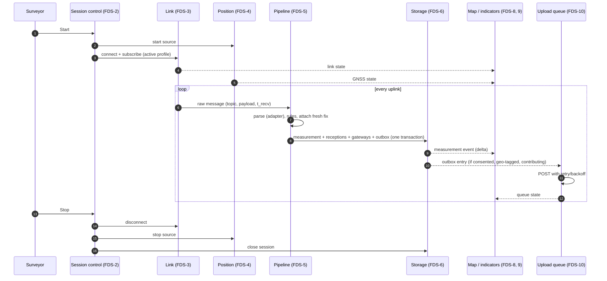
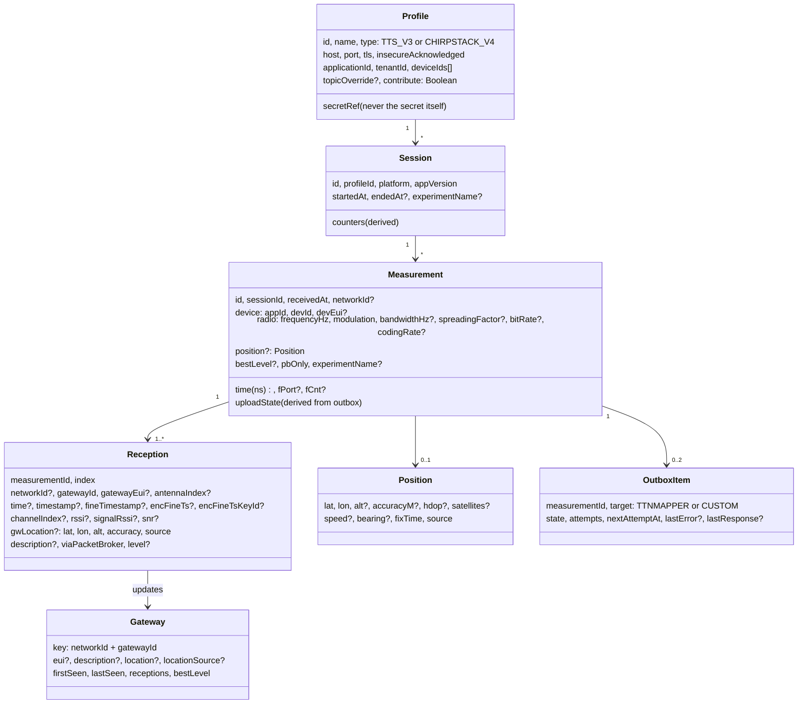
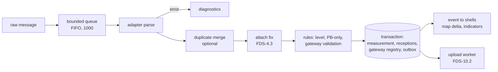
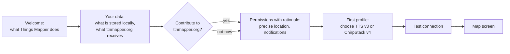
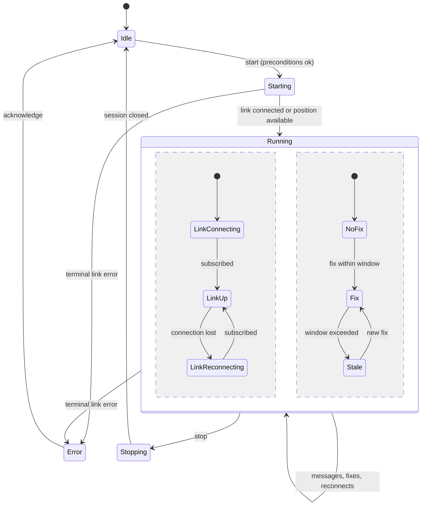
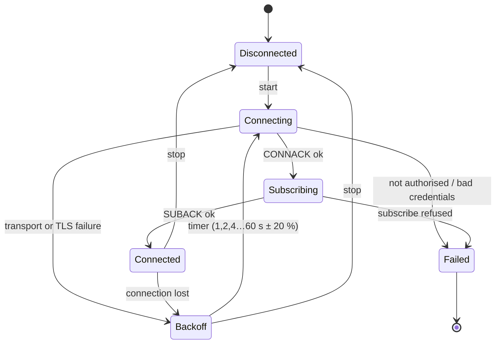
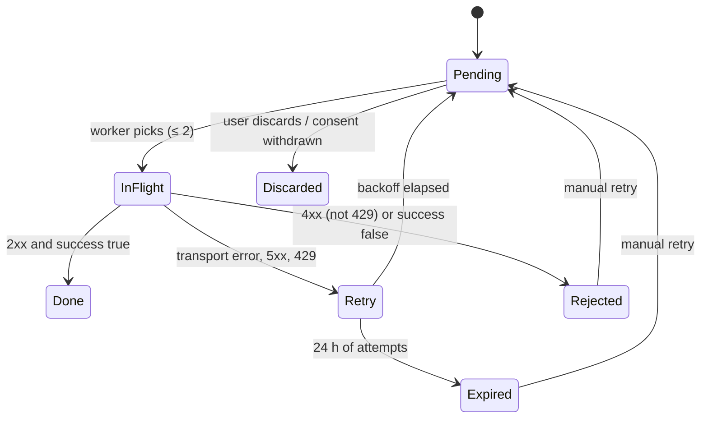

# 03 — Functional design specification (FDS)

Status: **Draft**

| Rev | Date | Author | Change |
|---|---|---|---|
| 0.1 | 2026-09-11 | R. Welling (with Claude) | First complete version |
| 0.2 | 2026-10-24 | R. Welling (with Claude) | Project renamed to Things Mapper; FDS-17 editions and advertising; car mode Paid-only; onboarding and settings additions |
| 0.3 | 2026-10-24 | R. Welling (with Claude) | Sponsor catalogue is the only ad source (OP-7); licence route L-A (OP-8); no ad consent |
| 0.4 | 2026-10-24 | R. Welling (with Claude) | Free start screen; cost awareness and voluntary support (ADR-0008) |

Related: [02 Requirements](02-requirements.md) (every function lists the
requirements it realises), [04 GUI design](04-gui-design.md) (screens
`SCR-nn`), [05 TDS](05-tds.md) (how the functions are built),
[06 Test plan](06-test-plan.md).

Numbering: **§n.m** refers to a section of this document; **FDS-n.m** is a
function identifier (all functions are in §4). Data contracts are in §3 and
are referenced from the requirements as "FDS §3.x".

---

## 1. Introduction

This document describes *what the system does* — its functions, rules, data
and behaviour — independent of the technology used to build it. It is
written for the reviewer who wants to check that the requirements are
covered and for the developer who wants to know the exact behaviour before
reading the technical design.

Two principles run through every function:

1. **Store first.** A received uplink is durably stored before anything else
   is done with it. Drawing, statistics and uploading are consequences of the
   stored record, never prerequisites.
2. **One core, several shells.** Every function below is defined once, in the
   core. Shells (phone, car, desktop, kiosk) differ only in how a function is
   presented or triggered, which is described in the GUI design.

## 2. Functional overview

### 2.1 Actors and external systems

| Actor / system | Role |
|---|---|
| Surveyor | Configures profiles, starts and stops sessions, looks at map and indicators, exports data |
| Network server (TTS v3, ChirpStack v4) | Publishes uplink events over MQTT |
| Position source | Delivers fixes: platform GNSS, gpsd, serial NMEA, car, manual, replay |
| ttnmapper.org ingress | Accepts measurements (HTTP POST) |
| Custom endpoint | Optional second receiver of measurements |
| Tile servers | Base map tiles; ttnmapper.org coverage tiles |
| Operating system | Background execution, notifications, secure storage, files |

### 2.2 Function tree

```mermaid
flowchart TB
    CM[Things Mapper]
    CM --> F1[FDS-1 Profiles and linking]
    CM --> F2[FDS-2 Session control]
    CM --> F3[FDS-3 Ingest]
    CM --> F4[FDS-4 Positioning]
    CM --> F5[FDS-5 Processing pipeline]
    CM --> F6[FDS-6 Storage and sessions]
    CM --> F7[FDS-7 Export and import]
    CM --> F8[FDS-8 Map and live view]
    CM --> F9[FDS-9 Indicators and statistics]
    CM --> F10[FDS-10 Upload]
    CM --> F11[FDS-11 Alerts and sounds]
    CM --> F12[FDS-12 Settings and onboarding]
    CM --> F13[FDS-13 Diagnostics]
    CM --> F14[FDS-14 Car mode]
    CM --> F15[FDS-15 Kiosk mode]
    CM --> F16[FDS-16 Replay tool]
    CM --> F17[FDS-17 Editions and advertising]
    CM --> F18[FDS-18 Cost awareness and support]
```



### 2.3 Main flow



## 3. Data contracts

### 3.1 Domain model



Field semantics follow TTN Mapper's `Link` table (evaluation EVAL-21) so
that exports remain comparable. Times are stored as UTC nanoseconds since the
Unix epoch; frequencies and bandwidths in Hz; EUIs as 16 upper-case hex
characters.

### 3.2 Protocol field extraction

Rules for both adapters: unknown members are ignored; members may be absent;
numbers may arrive as JSON numbers or as decimal strings (protobuf JSON
mapping emits 64-bit integers as strings); timestamps are RFC 3339 with up to
nanosecond precision. A message without any usable reception (empty
`rx_metadata`/`rxInfo`, or only the Packet Broker pseudo-gateway) is still a
measurement with zero receptions.

#### 3.2.1 The Things Stack v3 — `ApplicationUp` (topic `v3/{app}@{tenant}/devices/{dev}/up`)

| Measurement field | JSON path | Notes |
|---|---|---|
| appId | `end_device_ids.application_ids.application_id` | |
| devId | `end_device_ids.device_id` | |
| devEui | `end_device_ids.dev_eui` | hex string; kept only if 16 hex chars |
| time | `received_at` | network receive time → ns |
| fPort | `uplink_message.f_port` | absent for MAC-only uplinks → null (not 0) |
| fCnt | `uplink_message.f_cnt` | |
| frequencyHz | `uplink_message.settings.frequency` | string of Hz |
| modulation, bandwidthHz, spreadingFactor | `uplink_message.settings.data_rate.lora.{bandwidth, spreading_factor}` → `LORA` | |
| modulation, bitRate | `uplink_message.settings.data_rate.fsk.bit_rate` → `FSK` | |
| modulation, bandwidthHz, codingRate | `uplink_message.settings.data_rate.lrfhss.{operating_channel_width, coding_rate}` → `LR_FHSS` | |
| codingRate | `uplink_message.settings.data_rate.lora.coding_rate`, else `uplink_message.settings.coding_rate` | newer stacks moved it into `lora` |
| networkId | `NS_TTS_V3://{network_ids.tenant_id}@{network_ids.net_id}` | net_id 6 hex chars upper-case, zero-padded |
| simulated | `simulated` | if true the message is counted but **not** stored as a measurement |
| **per reception** (`uplink_message.rx_metadata[]`) | | |
| gatewayId | `gateway_ids.gateway_id` | `packetbroker` → see §3.3 |
| gatewayEui | `gateway_ids.eui` | else derived from `eui-xxxxxxxxxxxxxxxx` id |
| antennaIndex | `antenna_index` | default 0 |
| time | `time` | ns; if absent, the measurement time is used and flagged |
| timestamp | `timestamp` | gateway µs counter |
| fineTimestamp | `fine_timestamp` | |
| encFineTs, encFineTsKeyId | `encrypted_fine_timestamp`, `encrypted_fine_timestamp_key_id` | opaque strings |
| channelIndex | `channel_index` | |
| rssi, signalRssi, snr | `rssi`, `signal_rssi`, `snr` | `channel_rssi` is read as fallback for `rssi` |
| gwLocation | `location.{latitude, longitude, altitude, accuracy, source}` | `source` passed through verbatim (e.g. `SOURCE_REGISTRY`, `SOURCE_GPS`) |
| packetBroker | `packet_broker.{forwarder_net_id, forwarder_tenant_id, forwarder_cluster_id, forwarder_gateway_eui, forwarder_gateway_id}` | see §3.3 |

#### 3.2.2 ChirpStack v4 — `UplinkEvent` (topic `application/{applicationId}/device/{devEui}/event/up`, JSON marshalling)

| Measurement field | JSON path | Notes |
|---|---|---|
| appId | `deviceInfo.applicationName` (fallback `deviceInfo.applicationId`) | TTN Mapper v3 used the name |
| devId | `deviceInfo.deviceName` | |
| devEui | `deviceInfo.devEui` | upper-cased |
| time | `time` (event time), else first `rxInfo[].gwTime`/`rxInfo[].time`, else receipt time | |
| fPort, fCnt | `fPort`, `fCnt` | |
| frequencyHz | `txInfo.frequency` | Hz |
| modulation, bandwidthHz, spreadingFactor, codingRate | `txInfo.modulation.lora.{bandwidth, spreadingFactor, codeRate}` → `LORA` | `CR_4_5` → `4/5` |
| modulation, bitRate | `txInfo.modulation.fsk.datarate` → `FSK` | |
| modulation, bandwidthHz, codingRate | `txInfo.modulation.lrFhss.{operatingChannelWidth, codeRate}` → `LR_FHSS` | |
| dr (informational) | `dr` | stored for diagnostics only; **no regional table lookup** |
| networkId | convention of ttnmapper.org's chirp/v4 integration (open point OP-2); until settled: absent | tenant is available in `deviceInfo.tenantId` |
| **per reception** (`rxInfo[]`) | | |
| gatewayId | `eui-` + lower-case `gatewayId` | TTN Mapper v3 convention, keeps uploads consistent with existing data |
| gatewayEui | upper-case `gatewayId` | |
| antennaIndex | `antenna` | |
| time | `gwTime`, else `time`, else `nsTime` | ns |
| timestamp | not available in v4 JSON (`context` is opaque) | null |
| channelIndex | `channel` | |
| rssi, snr | `rssi`, `snr` | |
| gwLocation | `location.{latitude, longitude, altitude, accuracy, source}` | source enum passed through (`GPS`, `CONFIG`, …) |
| description | not available | null |
| crcStatus | `crcStatus` | receptions with a CRC status other than `CRC_OK` are dropped |

ChirpStack v3 JSON (`applicationName`, `devEUI`, `gatewayID`, `loRaSNR`)
is recognised by the presence of `devEUI` at the top level and rejected with
a distinct diagnostic ("ChirpStack v3 format — not supported"), unless the
optional legacy adapter is enabled (REQ-F-008, priority C).

### 3.3 Network id and Packet Broker rules

1. A reception whose `gateway_ids.gateway_id` equals `packetbroker` is
   discarded (it is the hub, not a gateway).
2. A reception with `packet_broker` metadata is *forwarded*:
   - `gatewayId` = `packet_broker.forwarder_gateway_id` when present, else the
     original id; `gatewayEui` = `packet_broker.forwarder_gateway_eui` when
     present, else derived from the id;
   - reception `networkId` = `thethingsnetwork.org` when
     `forwarder_tenant_id == "ttnv2"`, otherwise
     `NS_TTS_V3://{forwarder_tenant_id}@{forwarder_net_id}`;
   - `viaPacketBroker = true`.
3. A reception without `packet_broker` metadata inherits the measurement's
   `networkId`.
4. A measurement is **PB-only** when it has at least one reception and all
   of them are forwarded. It is drawn as a ring (§4.8) and uploaded normally
   (ttnmapper.org attributes the receptions to the forwarding networks).
5. EUI derivation: a gateway id of the form `eui-` + 16 hex characters yields
   the upper-cased hex as EUI when no explicit EUI is present.

### 3.4 Upload contract — ttnmapper.org `POST /android/v4`

`https://integrations.ttnmapper.org/android/v4/`, `Content-Type:
application/json`, one measurement per request. Members whose value is null
are **omitted** (Moshi default in the original app). Field order is not
significant. Response: `{"success": true|false, "message": "…"}`; HTTP 200 is
expected even for `success:false`.

| JSON key | Type | Source | Notes |
|---|---|---|---|
| `network_id` | string | measurement.networkId | omitted when unknown |
| `app_id`, `dev_id`, `dev_eui` | string | device ids | |
| `time` | integer | measurement.time | ns since epoch |
| `port`, `counter` | integer | fPort, fCnt | |
| `frequency` | integer | frequencyHz | Hz |
| `modulation` | string | `LORA`, `FSK`, `LR_FHSS` | |
| `bandwidth` | integer | bandwidthHz | Hz |
| `spreading_factor` | integer | | |
| `bit_rate` | integer | FSK only | |
| `coding_rate` | string | `4/5` form | |
| `gateways` | array | one object per reception | |
| `gateways[].network_id` | string | reception.networkId | |
| `gateways[].gtw_id`, `gtw_eui` | string | | |
| `gateways[].antenna_index` | integer | | |
| `gateways[].time` | integer | ns | |
| `gateways[].timestamp`, `fine_timestamp` | integer | | |
| `gateways[].fine_timestamp_encrypted`, `encrypted_fine_timestamp_key_id` | string | | base64 as delivered |
| `gateways[].channel` | integer | channelIndex | |
| `gateways[].rssi`, `signal_rssi`, `snr` | number | | |
| `gateways[].latitude`, `longitude` | number | gwLocation | |
| `gateways[].altitude`, `location_accuracy` | integer | gwLocation (rounded) | |
| `gateways[].location_source` | string | verbatim NS enum | |
| `gateways[].description` | string | | |
| `latitude`, `longitude`, `altitude` | number | position | required for upload |
| `accuracy_meters` | number | position.accuracyM | |
| `satellites` | integer | position.satellites | when known |
| `hdop` | number | position.hdop | when known |
| `accuracy_source` | string | position.source | `gps`, `fused`, `gpsd`, `nmea`, … |
| `experiment` | string | session.experimentName | omitted when not an experiment |
| `userid` | string | installation id (UUID) | |
| `useragent` | string | `ThingsMapper/<version> (<platform>; <os>)` | format subject to OP-1 |

Speed and bearing are **not** part of the contract and are not sent.

### 3.5 CSV export columns

RFC 4180: comma separator, CRLF line ends, UTF-8 without BOM, header row,
fields containing separators/quotes/newlines quoted, empty for null. One row
per reception; a measurement without receptions yields one row with empty
gateway columns. The legacy TTN Mapper column names and order are kept
(EVAL-21) and new columns are appended, so existing scripts keep working:

```
MeasurementId, ReceptionIndex,
Session, AppID, DevID, DevEui, Time, FPort, FCnt, Frequency, Modulation,
Bandwidth, SpreadingFactor, Bitrate, CodingRate, GatewayId, GatewayEui,
AntennaIndex, GatewayTime, GatewayTimestamp, FineTimestamp,
FineTimestampEncrypted, FineTimestampEncryptedKeyId, ChannelIndex, Rssi,
SignalRssi, Snr, GatewayLatitude, GatewayLongitude, GatewayAltitude,
GatewayLocationAccuracy, GatewayLocationSource, Latitude, Longitude,
Altitude, AccuracyMeters, Satellites, Hdop, AccuracySource, Experiment,
UserId, UserAgent,
NetworkId, GatewayNetworkId, ViaPacketBroker, Level, Speed, Bearing,
PositionAgeMs, UploadState
```

`Session` is the ISO-8601 UTC start time of the session (as in TTN Mapper);
`Time` and `GatewayTime` are ns since epoch (as stored), `Level` the computed
signal level.

### 3.6 GeoJSON export

A `FeatureCollection` containing, in this order: one `Point` feature per
geo-tagged measurement (`properties`: `kind: "measurement"`, `id`, `session`,
`time` (ISO-8601), `dev_id`, `f_cnt`, `frequency`, `sf`, `bw`, `best_level`,
`best_rssi`, `best_snr`, `gateways` (count), `pb_only`, `colour` (hex)),
optionally one `LineString` per reception with a valid gateway location
(`kind: "reception"`, `measurement_id`, `gateway_id`, `rssi`, `snr`,
`level`), and one `Point` per gateway with a valid location
(`kind: "gateway"`, `gateway_id`, `eui`, `network_id`, `description`,
`receptions`, `best_level`). Coordinates are `[lon, lat, alt?]`.

### 3.7 Profile file and provisioning file

**Profile JSON** (export, import, QR; never contains a secret):

```json
{
  "thingsmapper_profile": 1,
  "name": "My node on TTN eu1",
  "type": "tts_v3",
  "host": "eu1.cloud.thethings.network",
  "port": 8883,
  "tls": true,
  "application_id": "my-app",
  "tenant_id": "ttn",
  "device_ids": ["mapper-01"],
  "topic_override": null,
  "contribute": true
}
```

`type` is `tts_v3` or `chirpstack_v4`; ChirpStack profiles carry
`application_id` (UUID), `device_ids` (EUIs) and optional `username`.

**Provisioning file** (kiosk, `/etc/thingsmapper/config.toml` or
`~/.config/thingsmapper/config.toml`):

```toml
[app]
kiosk = true
auto_start_mapping = true
theme = "auto"           # light | dark | auto
locale = "nl"

[display]
orientation = "landscape" # landscape | portrait
keep_screen_on = true

[gnss]
source = "gpsd"          # gpsd | nmea | manual | replay
gpsd_host = "localhost"
gpsd_port = 2947
# nmea_device = "/dev/ttyACM0"
# nmea_baud = 9600

[upload]
consent = true           # explicit; false disables ttnmapper.org upload
experiment = ""          # non-empty marks all sessions as experiment

[[profiles]]
name = "TTN eu1"
type = "tts_v3"
host = "eu1.cloud.thethings.network"
port = 8883
tls = true
application_id = "my-app"
tenant_id = "ttn"
device_ids = ["mapper-01"]
api_key_file = "/etc/thingsmapper/secrets/ttn-eu1.key"   # or api_key_env = "THINGSMAPPER_TTN_KEY"
active = true
```

Secrets are read from `*_file` (mode 0600 required, otherwise refused with a
diagnostic) or `*_env`; they are never written back.

## 4. Functions

Each function lists: purpose, trigger, behaviour, rules, outputs, errors and
the requirements it realises.

### FDS-1 Profiles and linking

#### FDS-1.1 Manage profiles
*Purpose.* Keep the connection settings for one or more mapping devices.
*Behaviour.* Create, edit, duplicate, delete; a profile has the fields of
§3.1. Deleting the active profile is refused while a session runs. Secrets
are stored through the secure-storage port; the profile record holds only a
reference. *Realises* REQ-F-001, REQ-F-007, REQ-NF-021.

#### FDS-1.2 The Things Stack v3 profile
*Fields.* Host (presets `eu1`, `nam1`, `au1` `.cloud.thethings.network`;
free text), application id, tenant id (default `ttn`; empty allowed for
single-tenant), API key (secret), device ids (≥ 1), TLS (default on, port
8883; off → port 1883 and the *insecure acknowledged* flag must be set by the
user in the editor), contribute (default on), optional topic override.
*Derived.* MQTT username = `{application_id}@{tenant_id}` (or
`{application_id}` when tenant empty); topics = one
`v3/{username}/devices/{device_id}/up` per device, or
`v3/{username}/devices/+/up` with filtering when the user selects *all
devices of the application*. *Validation.* Ids match TTS id rules
(`^[a-z0-9](?:[-]?[a-z0-9]){2,}$`), key non-empty, host resolvable format.
*Realises* REQ-F-002, REQ-F-005, REQ-F-027.

#### FDS-1.3 ChirpStack v4 profile
*Fields.* Host, port (default 8883 with TLS, 1883 without), TLS (default on),
username/password (optional secret), application id (UUID), device EUIs
(≥ 1, 16 hex), optional topic prefix, contribute. *Derived.* Topics
`{prefix}application/{applicationId}/device/{devEui}/event/up`, or `+` for all
devices with filtering. *Realises* REQ-F-003, REQ-F-005.

#### FDS-1.4 Test connection
*Behaviour.* From the editor, run the link state machine (§5.2) once with the
edited values: resolve → connect → authenticate → subscribe → wait up to
60 s for a message → parse it. Report the first failing step with its cause
(DNS, TCP refused/timeout, TLS handshake/certificate, authentication refused,
authorisation refused on subscribe, no message within the wait, message
received but not parseable, success with device/gateway summary). The test
never stores anything and never uploads. *Realises* REQ-F-004.

#### FDS-1.5 Import, export, QR
*Behaviour.* Export writes the profile JSON of §3.7 (no secret). Import reads
it, shows the result for confirmation, then asks for the secret. On Android
the QR scanner accepts the same JSON (compact) — a QR code never carries the
secret; scanning one that appears to contain a key-like string is refused
with an explanation. *Realises* REQ-F-006.

#### FDS-1.6 Active profile
Exactly one profile is active. Activating another while a session runs asks
to stop the session first. The active profile is shown on the main screen.
*Realises* REQ-F-007.

### FDS-2 Session control

#### FDS-2.1 Start and stop
*Trigger.* Primary control (`SCR-02`, `SCR-03`, `SCR-30`, `SCR-40`),
notification action, kiosk auto-start. *Preconditions to start.* An active
profile exists; on Android the location permission (precise) and — API 33+ —
notification permission are granted (otherwise the permission flow of
FDS-12.1 runs first); a position source is configured. *Behaviour.* Start
creates a session, starts the position source and the link; the state
machine of §5.1 governs the rest. Stop disconnects, stops the source (unless
another consumer needs it), closes the session, flushes pending database
writes; queued uploads continue. *Realises* REQ-F-010, REQ-F-012.

#### FDS-2.2 Session state
States and transitions in §5.1. The state is published to all shells; the
notification (Android) mirrors it. *Realises* REQ-F-010, REQ-F-014.

#### FDS-2.3 Background operation
Android: the session runs inside a foreground service of type `location`,
started with `startForegroundService` and promoted with `startForeground`
immediately (within 5 s), holding a partial wake lock while a session is
active; the notification shows link, GNSS, packets and last-packet age and
offers *Stop*. Desktop/Pi: the process runs as long as the window or the
systemd unit lives. *Realises* REQ-F-011, REQ-F-015, REQ-F-092, REQ-NF-060.

#### FDS-2.4 Auto-start and resume (kiosk)
With `auto_start_mapping = true` a session starts as soon as the active
profile and the position source are available at launch; after a crash or
power loss the supervisor restarts the process and a new session starts
(the previous one is closed with its last known time). *Realises*
REQ-F-013, REQ-NF-012.

### FDS-3 Ingest

#### FDS-3.1 Link management
*Behaviour.* One MQTT connection per session (MQTT 3.1.1, clean session,
QoS 0 subscriptions, keep-alive 30 s, client id `thingsmapper-<random>`),
TLS per profile, credentials from secure storage. On loss the link
reconnects with exponential backoff 1, 2, 4 … 60 s (± 20 % jitter) for as
long as the session is active; each attempt and outcome is a diagnostic
event. Authentication (`CONNACK` not authorised / bad credentials) and
subscribe refusal are **terminal**: the session goes to *Error* with an
explanation and a link to the profile editor. Every other failure is
transient. Messages arriving while the pipeline is busy are queued (bounded,
see FDS-5.1). *Realises* REQ-F-020, REQ-F-025, REQ-F-027, REQ-NF-011,
REQ-NF-020.

#### FDS-3.2 Parsing
The adapter selected by the profile type applies §3.2 and produces a parsed
uplink or a parse error. Parsing is lenient: unknown members are ignored,
absent optional members are null, malformed values in optional members are
nulled with a diagnostic. *Realises* REQ-F-021, REQ-F-022.

#### FDS-3.3 Packet Broker and network id
§3.3 applied to every reception. *Realises* REQ-F-023, REQ-F-024.

#### FDS-3.4 Malformed messages
A parse error increments the *parse errors* counter, stores a redacted
sample (payload with any member named like `*key*`, `*password*`,
`*token*`, `*secret*` masked, truncated to 4 kB) in the diagnostics ring
buffer (last 20), and leaves the session running. Ten consecutive parse
errors raise the *format mismatch* warning ("Messages arrive but cannot be
read — check the profile type"). *Realises* REQ-F-022, REQ-F-112.

#### FDS-3.5 Duplicate merge (optional)
Two parsed uplinks with the same device, `fCnt` and `time` within 30 s are
merged: receptions of the second are appended to the first measurement if
it has not been uploaded yet, otherwise the second is stored as a separate
measurement flagged *duplicate*. Off by default. *Realises* REQ-F-026.

### FDS-4 Positioning

#### FDS-4.1 Sources
| Source | Platform | Delivers |
|---|---|---|
| `gps` | Android (platform GNSS, GPS provider) | lat, lon, alt, accuracy, speed, bearing, fix time, satellites (from GNSS status when available) |
| `fused` | Android with Play Services flavour | as `gps` without satellites |
| `network` | Android | coarse; used only as last resort for display, never for geo-tagging when accuracy > 50 m |
| `gpsd` | Linux/Pi | TPV/SKY reports: lat, lon, alt, epx/epy → accuracy, hdop, satellites used, speed, track |
| `nmea` | Linux/Pi (serial/USB) | GGA/RMC/GSA: lat, lon, alt, hdop, satellites, speed, course; accuracy estimated from HDOP × 5 m |
| `car` | Android Auto | host location when granted |
| `manual` | all | fixed lat/lon/alt with a nominal accuracy, flagged |
| `replay` | all | positions from a GPX/NMEA file in step with the replay tool |
*Realises* REQ-F-030, REQ-F-032.

#### FDS-4.2 Fix selection
The *current fix* is the most recent fix whose accuracy is not worse than
the best fix received in the last freshness window by more than a factor 3;
a coarser fix replaces a finer one only when the finer one has expired.
Source priority breaks ties: `gps`/`gpsd`/`nmea`/`car` > `fused` >
`network` > `manual`. *Realises* REQ-F-033.

#### FDS-4.3 Freshness and geo-tagging
When a parsed uplink is processed, the current fix is attached if its fix
time is within the freshness window (default 10 s, setting 5–30 s) of the
uplink's receipt time; otherwise the measurement is stored without position
(`positionAgeMs` records the age of the best available fix for diagnostics).
*Realises* REQ-F-031, REQ-F-044.

#### FDS-4.4 GNSS status
Published every second: state (`no source`, `searching`, `fix`, `stale`),
accuracy, satellites (if known), age, source. Warnings: accuracy > 10 m
(ttnmapper.org's quality threshold), stale > freshness window. *Realises*
REQ-F-034, REQ-F-091.

### FDS-5 Processing pipeline

#### FDS-5.1 Stages and ordering

A single worker processes the queue in order. Back-pressure: when the queue
is full the oldest raw message is dropped **and counted** (never silently);
at 10 messages/s sustained the queue must not fill on any target platform
(REQ-NF-002). *Realises* REQ-F-045, REQ-NF-010.

#### FDS-5.2 Level and colour
`level = rssi + min(snr, 0)` per reception (null when `rssi` is null);
measurement `bestLevel = max(level)`; colour by the table of REQ-F-040.
*Realises* REQ-F-040, REQ-F-041.

#### FDS-5.3 Gateway validation and registry
A gateway location is valid when present, not on null island
(`|lat| < 1 ∧ |lon| < 1`), `|lat| ≤ 90`, `|lon| ≤ 180`. The registry entry
(key `networkId + gatewayId`) is created or updated with EUI, description,
location (a valid location replaces an invalid or absent one; a changed valid
location is recorded as *moved*), first/last seen, count and best level.
Marker and line are produced only for valid locations. *Realises*
REQ-F-042, REQ-F-043.

#### FDS-5.4 Experiment
The session's experiment name (if set) is copied to every measurement at
storage time and is immutable afterwards. Default name
`experiment_<installation-id>`. *Realises* REQ-F-046.

#### FDS-5.5 Normalisation
Units and formats of REQ-F-047. Coding rate forms `CR_4_5` → `4/5`;
`4/5LI` kept as delivered. *Realises* REQ-F-047.

### FDS-6 Storage and sessions

#### FDS-6.1 Persistence
Entities of §3.1 in a local database; all writes of one uplink in one
transaction (outbox pattern: the upload items are written together with the
measurement so that no stored, consented measurement can miss the queue).
Migrations are versioned and tested. *Realises* REQ-F-050, REQ-F-056,
REQ-NF-010, REQ-NF-013.

#### FDS-6.2 Sessions screen
Lists sessions newest first with start time, duration, profile name,
measurements (with/without position), receptions, upload state
(`n pending / m done / k rejected`). Actions: open detail, export, delete
(confirmation), delete all (confirmation with count), select several for
export or map display. *Realises* REQ-F-051, REQ-F-065.

#### FDS-6.3 Retention
When the database exceeds the configured size (default 1 GB desktop/Pi,
512 MB phone) a warning appears with a shortcut to export and delete the
oldest sessions; nothing is deleted automatically. *Realises* REQ-F-055.

### FDS-7 Export and import

#### FDS-7.1 CSV
Streams the rows of §3.5 for the selected sessions to the destination chosen
through the platform (Android: `ACTION_CREATE_DOCUMENT` with MIME
`text/csv`, plus share sheet; desktop: save dialog; kiosk: export folder or
first mounted removable volume). File name
`thingsmapper-<session-start-UTC>.csv` or `thingsmapper-all-<now-UTC>.csv`.
Progress and cancel for large exports. *Realises* REQ-F-052, REQ-F-053.

#### FDS-7.2 GeoJSON
As FDS-7.1 with §3.6; MIME `application/geo+json`. *Realises* REQ-F-052.

#### FDS-7.3 Import (optional)
Reads a CSV produced by TTN Mapper v3 (its 41 legacy columns, header
detected) or by Things Mapper, creates a session per distinct `Session`
value flagged *imported* (never uploaded), and shows it on the map.
*Realises* REQ-F-054.

### FDS-8 Map and live view

#### FDS-8.1 Map model and layers
The map is a viewport (centre, zoom 2–19, optional rotation) over ordered
layers: base tiles → coverage overlay → reception lines → measurement points
→ gateway markers → own position → attribution. Points: filled circle in the
level colour with a thin dark outline; PB-only: ring; without position: not
drawn. Lines: from measurement to each gateway with valid location, colour of
the reception's level. Gateway markers: symbol with tap target ≥ 48 dp;
tapping opens the gateway sheet (`SCR-12`). Layer toggles: coverage, lines,
gateways, points of earlier sessions. *Realises* REQ-F-063, REQ-F-064,
REQ-F-066.

#### FDS-8.2 Base maps and attribution
Presets: OpenStreetMap standard (`https://tile.openstreetmap.org/{z}/{x}/{y}.png`),
greyscale (same tiles, desaturated at render time), night (same tiles,
inverted/darkened at render time), and *custom XYZ* (URL template with
`{z}/{x}/{y}` and `{s}` subdomains, attribution text, min/max zoom, terms
acknowledged). Every tile request carries
`User-Agent: ThingsMapper/<version> (+https://github.com/pe1mew/Things-Mapper)`;
at most 2 concurrent requests per host; tiles are cached on disk (LRU,
default 200 MB phone, 1 GB desktop/Pi, TTL 7 days honouring `Cache-Control`);
the attribution of the active source is always visible. No imagery preset is
shipped. *Realises* REQ-F-061, REQ-F-069, REQ-NF-006, REQ-NF-061, REQ-C-007.

#### FDS-8.3 Coverage overlay
Tile URL `https://tms.ttnmapper.org/circles/network/{urlencode(networkId)}/{z}/{x}/{y}.png`
with the active profile's network id; when the network id is unknown (e.g.
ChirpStack before OP-2 is settled) the overlay control shows *not available
for this network*. Opacity 20–100 % (default 50 %). *Realises* REQ-F-062.

#### FDS-8.4 Follow mode
*Follow* keeps the current fix centred (with an optional heading-up
rotation on phone/car); any manual pan disables follow and shows the
re-centre control; the control re-enables it. Zoom does not disable follow.
Map state persists (REQ-F-067). *Realises* REQ-F-060.

#### FDS-8.5 Gateway sheet
Shows id, EUI, network, description, location source, distance and bearing
from the current fix, receptions in this session, best level, first/last
seen; action *show on map*. *Realises* REQ-F-073.

### FDS-9 Indicators and statistics

#### FDS-9.1 Live indicators
| Indicator | Value | States |
|---|---|---|
| Link | profile name, state | `off`, `connecting`, `connected`, `reconnecting (n)`, `error` |
| GNSS | accuracy m, satellites, age | `none`, `searching`, `ok (≤ 10 m)`, `poor (> 10 m)`, `stale` |
| Last packet | age (s / min), best RSSI dBm, best SNR dB, gateway count, PB-only flag | `—` before first packet; *warning* when age > alert threshold |
| Session | packets (with / without position), duration, distance | |
| Upload | consent state; queue depth; last result | `off`, `idle`, `sending (n)`, `retrying (n, next in s)`, `rejected (k)` |
Indicators update within 1 s of the underlying change. *Realises*
REQ-F-070, REQ-F-083.

#### FDS-9.2 Session statistics
Computed from stored data on demand: packets, packets without position,
unique gateways, distance (sum of great-circle distances between successive
geo-tagged measurements, ignoring jumps > 1 km within 1 s), best and worst
level, histogram of levels in the six legend classes, per-gateway table
(receptions, best level, maximum distance measurement↔gateway). *Realises*
REQ-F-071.

#### FDS-9.3 Drive view
The indicators of FDS-9.1 in large type with the primary control; no map
interaction; automatically dark at night. *Realises* REQ-F-072, REQ-NF-030.

### FDS-10 Upload

#### FDS-10.1 Eligibility
An outbox item for ttnmapper.org is created when: upload consent is on
**and** the profile's *contribute* is on **and** the measurement has a
position **and** the session is not *imported*. An item for the custom
endpoint is created when the endpoint is enabled and the measurement has a
position. Consent changes apply to future measurements only; turning consent
off also discards pending ttnmapper.org items after confirmation.
*Realises* REQ-F-081, REQ-F-086.

#### FDS-10.2 Queue and retry
A worker per target sends items in order (per session), at most 2 in
flight. Success (HTTP 2xx and `success:true`) → *done*. Transport failure or
HTTP 5xx/429 → *retry* with backoff 5 s, 30 s, 2 min, 10 min, 30 min, 1 h
(then hourly) up to 24 h of attempts, after which the item is *expired*
(kept, visible, manually retryable). HTTP 4xx other than 429, or
`success:false` → *rejected* with the server message; rejected items are not
retried automatically. The queue survives restarts; a network-available
signal triggers an immediate attempt. *Realises* REQ-F-082, REQ-F-083,
REQ-F-088, REQ-NF-010.

#### FDS-10.3 Payload
§3.4, built from the stored measurement at send time (so that a later fix of
the payload builder can re-send). `useragent` per OP-1. *Realises* REQ-F-080,
REQ-F-084, REQ-F-087.

#### FDS-10.4 Custom endpoint
Same payload to a user-configured HTTPS URL with optional `Authorization`
header (bearer token or basic credentials from secure storage); plain HTTP
only with acknowledgement. Its results are shown separately. *Realises*
REQ-F-085.

### FDS-11 Alerts and sounds
Per-packet sound (and vibration on phones) when enabled; alert conditions
*GNSS lost > 30 s*, *link down > 30 s*, *no packet for N min* (N default 5)
raise a visual banner and, when enabled, a distinct sound; alerts clear
automatically when the condition ends. Sounds respect the platform's audio
focus and silent mode. *Realises* REQ-F-090, REQ-F-091.

### FDS-12 Settings and onboarding

#### FDS-12.1 Onboarding

Onboarding runs once; every step is reachable again from settings. On
desktop/kiosk with a provisioning file the steps that the file answers are
skipped. No edition has an ad-consent step (FDS-17.4). In the Free edition
the *Welcome* step also carries the start-screen notice (FDS-17.5).
*Realises* REQ-F-100, REQ-NF-023.

#### FDS-12.2 Settings catalogue
| Group | Settings |
|---|---|
| Profiles | list, add, edit, import, export, active |
| Mapping | freshness window (5–30 s), accuracy warning threshold (default 10 m), duplicate merge, experiment (flag, name) |
| Map | base map preset, custom source, coverage overlay + opacity, lines, gateways, legend, follow rotation, tile cache size + clear |
| Upload | consent, installation id (show, reset), custom endpoint (URL, auth, enabled), Wi-Fi only |
| Alerts & sounds | packet sound (+ picker on Android), vibration, alert thresholds |
| Display | theme light/dark/auto, keep screen on, units |
| Diagnostics | open diagnostics, export bug report, log level |
| About | version, edition, licence (GPL-3.0), third-party notices, privacy page, links |
| Edition | Free: *Get the ad-free edition with Android Auto*; Paid: *Import from Things Mapper (Free)* (FDS-17.5); both editions: *Become a sponsor* and *About sponsor banners* in About |
| Support | *Support Things Mapper* (FDS-18.5), *What Things Mapper costs* (FDS-18.2), supporter status, *Restore purchases* and *Manage subscription* (store builds), *What's new* with *Why this update* (FDS-18.3) |
*Realises* REQ-F-101, REQ-F-102, REQ-F-103, REQ-F-087, REQ-F-157, REQ-F-158, REQ-F-163…166.

### FDS-13 Diagnostics

#### FDS-13.1 Event log and counters
Ring buffer of the last 500 events (link, GNSS source, uploads, parse
errors, queue drops) with timestamps and the counters of REQ-NF-050;
persisted logs on desktop/Pi rotate at 10 MB × 5. *Realises* REQ-F-110,
REQ-NF-050.

#### FDS-13.2 Bug-report bundle and redaction
A ZIP with `report.txt` (versions, platform, settings without secrets,
counters), `events.log` (redacted), optionally `messages.json` (last 20 raw
messages, redacted, only when the user ticks the option). Redaction masks
values of members whose names match `key|password|token|secret|authorization`
and any string that matches the shape of a TTS API key (`NNSXS.` prefix).
Profiles appear with host and ids only. *Realises* REQ-F-111, REQ-F-112,
REQ-NF-021.

### FDS-14 Car mode (Android Auto)

Available in the **Paid edition only** (REQ-F-160, FDS-17.1). The Free
edition contains no car service and never appears on a car screen, so no
advertisement can reach the car.

#### FDS-14.1 Templates
Main screen: `MapWithContentTemplate` — the app draws the map (points,
lines, gateway markers, own position, follow mode always on, night colours
from the host) on the provided surface, the content pane lists the
indicators of FDS-9.1 as rows (link, GNSS, last packet, session, upload) and
the action strip offers *Start*/*Stop* and *Profiles* (list of saved
profiles, selection only). Fallback (IoT category): `GridTemplate` with the
same indicators as tiles and a *Start/Stop* action; a `ListTemplate` with the
last 10 packets. *Realises* REQ-F-120, REQ-F-121, REQ-F-122.

#### FDS-14.2 Behaviour
The car session is the phone session: starting from the car starts the
foreground service on the phone; stopping in either place stops both. No
text entry, no settings other than profile choice and sound on/off. Position
from the car host is used when granted and more accurate than the phone's
(REQ-F-123). *Realises* REQ-F-120, REQ-NF-032.

### FDS-15 Kiosk mode (Raspberry Pi and desktop)

#### FDS-15.1 Shell
Full-screen window without decorations, layouts `SCR-30`/`SCR-31`,
on-screen keyboard (in-app, alphanumeric + symbols) for the text fields of the
profile editor and settings, long-press (3 s) on the app title for the
*exit/shut down* dialog. *Realises* REQ-F-130, REQ-F-134.

#### FDS-15.2 Configuration file
§3.7 read at start; the UI shows file-provided values as read-only with the
file path; secrets from `*_file`/`*_env`. Errors in the file are shown on a
start screen with the line number; the app still starts without the faulty
profile. *Realises* REQ-F-131.

#### FDS-15.3 Supervision and resilience
Packaged with a systemd user unit (`Restart=on-failure`, `RestartSec=5`);
the app writes a heartbeat; session resume per FDS-2.4; connectivity loss is
handled by FDS-3.1 and FDS-10.2; tiles come from the cache. Optional status
page (`http://localhost:8787/status`, read-only JSON and HTML) when enabled.
*Realises* REQ-F-133, REQ-F-135, REQ-NF-012.

### FDS-16 Replay tool
Command-line tool `thingsmapper-replay` with: a *recording* mode that
subscribes to a profile's topics and writes messages with receipt timestamps
to a JSON-lines file (redacting nothing — recordings are the user's own
data, but the tool warns that they contain device ids); a *publish* mode that
replays a recording to a broker (topic rewrite option, speed factor,
loop); a *track* mode that serves a GPX/NMEA track as a gpsd-compatible
TCP stream (`TPV`/`SKY` JSON) in step with the recording. The in-app
`replay` position source and a *demo* profile (local broker) use the same
files. *Realises* REQ-F-140, REQ-F-141.

### FDS-17 Editions and advertising

Decision record: [ADR-0007](adr/ADR-0007-editions-and-monetisation.md).

#### FDS-17.1 Editions
The edition is a build-time constant; there is no runtime unlock.

| Aspect | Free | Paid | Desktop / kiosk |
|---|---|---|---|
| Functions FDS-1…13, 15, 16 | all | all | all of the platform |
| FDS-14 Car mode (Android Auto) | — (no car service) | ✔ | — |
| Advertisements (FDS-17.2–17.4) | ✔ | — | — |
| Start screen (FDS-17.5) | ✔ | — | — |
| Upgrade entry (FDS-17.5) | ✔ | — | — |
| Import from Free (FDS-17.5) | — | ✔ | — |
| Android application id | `nl.pe1mew.thingsmapper` | `nl.pe1mew.thingsmapper.paid` | — |

*Realises* REQ-F-150…152, REQ-F-160, REQ-F-161.

#### FDS-17.2 Ad slots and visibility
An ad slot is a reserved banner area on a screen. A slot is **visible** only
when all of the following hold:

1. the edition is Free;
2. the screen has a slot (table below);
3. on the map screen: the session state is *Idle* or *Error* (not
   *Starting*, *Running* or *Stopping*);
4. no dialog, bottom sheet or onboarding step is shown;
5. the sponsor catalogue has a valid banner for the slot (FDS-17.3);
6. the device is online.

An invisible slot takes no space (it collapses); it never shows a
placeholder, error text or progress indicator.

| Screen | Slot | Visible while a session runs |
|---|---|---|
| SCR-02 Map (phone) | banner directly below the indicator chips, full width | **no** — collapses on *Start* |
| SCR-03 Drive view | none | — |
| SCR-04 Statistics, SCR-05 Sessions, SCR-06 Session detail, SCR-07 Profiles, SCR-09 Settings, SCR-10 Diagnostics, SCR-11 About | banner at the bottom of the content, above the bottom navigation | yes |
| SCR-20 expanded layout (Android tablets) | banner at the top of the side panel on the *Statistics* and *Gateways* tabs; on the *Live* tab only while no session runs | as left |
| SCR-01 Onboarding, SCR-08 Profile editor, SCR-12 Gateway sheet, SCR-13 Alerts & dialogs, SCR-14 Free start screen, SCR-15 Cost page, SCR-16 Thank-you card, SCR-17 Support | none | — |
| Notifications, lock screen, widgets | none | — |
| Car screens SCR-40/41 | not present in the Free edition | — |

Spacing: a slot keeps ≥ 48 dp from the Start/Stop control and from the map
controls and never covers the map attribution. Formats: banners only
(320×50 dp phone, 728×90 dp tablet); no interstitial, full-screen, rewarded,
video or audio ads. *Realises* REQ-F-153, REQ-F-156.

#### FDS-17.3 Ad sources
**Sponsor catalogue — the only ad source (OP-7).** A JSON catalogue and a
detached signature are published on the project's static site:

```
https://pe1mew.github.io/Things-Mapper/ads/v1/catalogue.json
https://pe1mew.github.io/Things-Mapper/ads/v1/catalogue.json.sig   (Ed25519, public key built into the app)
```

```json
{
  "thingsmapper_ads": 1,
  "generated": "2026-11-01T00:00:00Z",
  "expires": "2026-12-31T23:59:59Z",
  "banners": [
    {
      "id": "vendor-x-2026q4",
      "sponsor": "Vendor X",
      "image_320x50": "https://pe1mew.github.io/Things-Mapper/ads/v1/img/vendor-x-320x50.webp",
      "image_728x90": "https://pe1mew.github.io/Things-Mapper/ads/v1/img/vendor-x-728x90.webp",
      "alt": { "en": "Vendor X LoRaWAN gateways", "nl": "Vendor X LoRaWAN-gateways" },
      "target": "https://vendor-x.example/lorawan",
      "languages": ["en", "nl"],
      "valid_from": "2026-11-01", "valid_to": "2026-12-31",
      "weight": 2
    }
  ]
}
```

Rules: the catalogue is fetched at most once per 24 h and only when a slot
becomes visible; a catalogue with an invalid signature or past `expires` is
discarded (no ads); images are static PNG/WebP ≤ 100 kB, fetched once and
cached; banners are chosen locally by language, validity and weight and
rotate every 60 s while a slot is visible; a tap opens `target` (https only)
in the external browser with `utm_source=thingsmapper&utm_medium=app`
appended. Requests carry no identifier (plain GET with the standard
User-Agent); impressions and clicks are not reported.

Sponsor content rules (published on the *Become a sponsor* page and checked
by the maintainer before a banner enters the catalogue): relevant to
LoRaWAN, IoT, radio, mapping or the open-source community; static image, no
animation, no tracking pixels or redirect chains; no political, gambling or
adult content; the target page is reachable over https. *About* links to
the *Become a sponsor* page.

*Realises* REQ-F-154, REQ-F-159.

#### FDS-17.4 Ad consent
No ad consent is needed and none is asked: the sponsor catalogue reads
and stores nothing on the device for advertising (the cached catalogue and
images are a functional cache without identifiers) and no request carries an
identifier. *About → About sponsor banners* explains this in two sentences.
REQ-F-155 is withdrawn (OP-7).

#### FDS-17.5 Start screen, upgrade entry and import
*Free — start screen (SCR-14):* shown when the app UI is started from the
launcher (cold start of the task). Not shown when the app returns from the
background, when it is opened from the mapping notification, after a
configuration change or process restore, or while a session runs. On the
very first start the onboarding's *Welcome* step (FDS-12.1) carries the same
notice instead. Content: *Things Mapper — Free*; what the Paid edition adds
(no sponsor banners, no start screen, Android Auto) and its price (€6 once,
from the funding data's `paid_price` in the user's currency, otherwise "a
one-time purchase"); the buttons *Buy the Paid edition* (opens the Paid
listing) and *Continue with Free*, both active immediately; a link to the
cost page (FDS-18.2). No sponsor or third-party content.

*Free — upgrade entry:* *Settings* and *About* contain *Get the ad-free
edition with Android Auto*, which opens the Paid edition's store listing.
Besides the start screen the Paid edition is promoted nowhere else — not on
the map, drive view, notifications or in other pop-ups.

*Paid:* at first start, if the Free edition is installed on the device, a
dialog offers *Import from Things Mapper (Free)*; the same action is in
*Settings*. The import copies, through a provider that only apps signed with
the same key can use:

| Data | Rule |
|---|---|
| Profiles | without secrets; the profile list marks profiles that need their API key or password re-entered |
| Sessions, measurements, receptions, gateways | complete; sessions keep their ids, so a repeated import skips what exists |
| Pending uploads | moved: the Paid edition re-creates them in its outbox, then tells the Free edition to mark them *transferred* so they are not sent twice |
| Settings, map state, installation id | copied (the installation id is kept so the contributions stay linked to the same `userid`) |

A summary is shown at the end; the user is advised to uninstall the Free
edition. On iOS (phase 4) the same import uses a shared App Group
container. *Realises* REQ-F-157, REQ-F-158, REQ-F-162.

#### FDS-17.6 Parity guarantee
Every function of this document except FDS-14 and FDS-17 behaves
identically in both editions, including data formats, uploads, exports and
diagnostics. The system test suite runs against both editions (TC-ED-01).
*Realises* REQ-F-151.

### FDS-18 Cost awareness and support

Decision record: [ADR-0008](adr/ADR-0008-cost-awareness-and-support.md);
figures: [08 Costs and funding](08-costs-and-funding.md).

#### FDS-18.1 Funding data
The signed funding file of doc 08 §6 is used by every build (Free, Paid,
desktop, kiosk). It is fetched at most once per 24 h and only when the cost
page, the start-screen price line or the thank-you card needs it; the
signature is verified with the built-in key (the same as for the sponsor
catalogue); the file is cached with its `updated` date; the request carries
no identifier. Figures older than 120 days are shown with the note
*figures may be outdated*. *Realises* REQ-F-167.

#### FDS-18.2 Cost page (SCR-15)
*What Things Mapper costs* shows: this year's costs as a total with the
recurring items and the year's share of investments; income so far by
source (Paid sales, supporters, sponsors) as one bar with the covered
percentage; investments still to recover; the note that development time is
volunteered; the date of the figures; the buttons *Support Things Mapper*
(FDS-18.5) and *Become a sponsor*; a link to doc 08. Offline without a
cached file it shows a static explanation of the cost items without
amounts. Reachable from *About*, the *Support* settings group, the Free start
screen and the thank-you card. *Realises* REQ-F-163.

#### FDS-18.3 Why this update
Every release note has a mandatory *Why this update* line naming the
mandatory platform work in the release, or "feature release" when there is
none (template in the release process; CI refuses a release whose store
changelog lacks it). *About → What's new in <version>* shows the notes of
the installed version including that line. There is no dialog after an
update. *Realises* REQ-F-164.

#### FDS-18.4 Yearly thank-you card (SCR-16)
Trigger: the user stops a session (FDS-2.1) while the app is in the
foreground. The card is shown when all of the following hold:

1. at least 30 days since installation and at least 3 sessions;
2. at least 12 months since the card was last shown (or since installation);
3. the user is not a supporter (FDS-18.5);
4. the speed of the last fix is below 5 km/h, or unknown;
5. it is not the car screen and no other dialog is open.

Content: *Thank you for mapping!*, the user's figures of the last 12 months
from the local database (sessions, distance, packets, unique gateways), one
line from the funding data (*Keeping Things Mapper in the stores costs about
€X this year; Y % is covered so far*; without numbers when no funding data is
available), and the buttons *Support* (opens SCR-17) and *Not now*. Either
button closes the card and restarts the 12-month timer. The card is never
shown while a session runs and never at app start. *Realises* REQ-F-165.

#### FDS-18.5 Voluntary support (SCR-17)
**Store builds** offer these products through the store's billing:

| Product id | Type | Price (decided 2026-10-24) |
|---|---|---|
| `support_yearly` | auto-renewing subscription, one year | €5 |
| `tip_small`, `tip_medium`, `tip_large` | consumable | €2, €5, €10 |

SCR-17 lists them with the store's localised prices; a purchase opens the
store's purchase sheet; on success the purchase is acknowledged (tips are
consumed), a thank-you message appears and the user becomes a supporter.
Supporter = an active subscription, or a tip within the last 12 months.
Effects: the badge *Supporter — thank you* in *About* and no thank-you card;
**nothing else changes** — no function is unlocked, and the Free edition
keeps its banners and start screen (the Paid edition removes those).
*Restore purchases* is in settings; *Manage subscription* opens the store's
subscription page. Purchases are verified locally through the store
library; there is no Things Mapper server.

**Other builds** (`foss` variants, desktop, kiosk): SCR-17 shows the same
explanation and one button that opens the maintainer's GitHub Sponsors page
in the browser; tapping it records a local date that keeps the thank-you
card away for 12 months.

Store builds never show a link to outside payment. *Realises* REQ-F-166,
REQ-C-011.

## 5. State machines

### 5.1 Session



*Running* is entered as soon as the session can do something useful;
measurements without position are still stored while `NoFix`/`Stale`.

### 5.2 Link



### 5.3 Outbox item



## 6. Error handling

| Situation | Detection | User-facing behaviour | Recovery |
|---|---|---|---|
| Wrong credentials | CONNACK not authorised | Session → Error: "The network server refused the credentials of profile *X*." Button: edit profile | User edits, restarts |
| TLS certificate invalid | handshake failure | Error with certificate subject and issuer; option to configure a custom CA in the profile | Profile edit |
| Broker unreachable | DNS/TCP/timeout | Link `reconnecting (n)`, session continues | Automatic backoff |
| Messages not parseable | 10 consecutive parse errors | Warning banner "format mismatch", diagnostics show sample | User checks profile type |
| No fix | no position within 60 s of start | GNSS indicator `searching`, banner after 60 s | Automatic |
| Fix too old / inaccurate | FDS-4.3 / 4.4 | Measurement stored without position; indicator `stale`/`poor` | Automatic |
| Queue overflow | FDS-5.1 | Counter + warning "n messages dropped" | Reduce uplink rate; report |
| Upload rejected | `success:false` | Indicator `rejected (k)`; diagnostics show server message | Manual retry after fix |
| Upload expired | 24 h | Indicator; sessions screen shows count | Manual retry |
| Storage full / DB error | write failure | Session → Error with reason; export offered | Free space |
| Permission revoked (Android) | callback | Session stops with notification; main screen explains | Re-grant |
| Provisioning file error | parse at start | Start screen with line number | Fix file |
| Ad cannot be loaded (Free) | catalogue unavailable, expired or signature invalid; offline | slot collapses; nothing is shown | automatic at the next visible period |
| Import from Free fails (Paid) | provider unavailable or data error | dialog with reason; nothing partially imported for a session | retry from settings; fallback export/import files |
| Purchase cancelled or failed | store billing result | store's own message; nothing changes in the app | user retries |
| Funding data unavailable or invalid | fetch/signature failure | cost page shows cached figures with their date, or the explanation without amounts; card without numbers | automatic at the next fetch |

## 7. Traceability (function → requirements)

| Function | Requirements |
|---|---|
| FDS-1.1–1.6 | REQ-F-001…008, REQ-F-027, REQ-NF-021 |
| FDS-2.1–2.4 | REQ-F-010…015, REQ-F-092, REQ-NF-012, REQ-NF-060 |
| FDS-3.1–3.5 | REQ-F-020…027, REQ-F-112, REQ-NF-011, REQ-NF-020 |
| FDS-4.1–4.4 | REQ-F-030…034, REQ-F-044, REQ-F-091 |
| FDS-5.1–5.5 | REQ-F-040…047, REQ-NF-002, REQ-NF-010 |
| FDS-6.1–6.3 | REQ-F-050, 051, 055, 056, 065, REQ-NF-010, REQ-NF-013 |
| FDS-7.1–7.3 | REQ-F-052…054 |
| FDS-8.1–8.5 | REQ-F-060…069, 073, REQ-NF-006, REQ-NF-061, REQ-C-007 |
| FDS-9.1–9.3 | REQ-F-070…072, 083, REQ-NF-030 |
| FDS-10.1–10.4 | REQ-F-080…088, REQ-NF-010 |
| FDS-11 | REQ-F-090, 091 |
| FDS-12.1–12.2 | REQ-F-087, 100…103, REQ-NF-023 |
| FDS-13.1–13.2 | REQ-F-110…112, REQ-NF-021, REQ-NF-050 |
| FDS-14.1–14.2 | REQ-F-120…123, REQ-F-160, REQ-NF-032 |
| FDS-15.1–15.3 | REQ-F-130…135, REQ-NF-012 |
| FDS-16 | REQ-F-140, 141 |
| FDS-17.1–17.6 | REQ-F-150…162, REQ-NF-022, REQ-NF-060, REQ-NF-063, REQ-NF-064 |
| FDS-18.1–18.5 | REQ-F-163…167, REQ-C-011, REQ-NF-060 |

Requirements not realised by a function: REQ-P-* (platforms — GUI design and
TDS), REQ-NF-001/003/004/005 (performance — TDS and test plan),
REQ-NF-024/040…044 (engineering — TDS and implementation plan), REQ-C-*.
