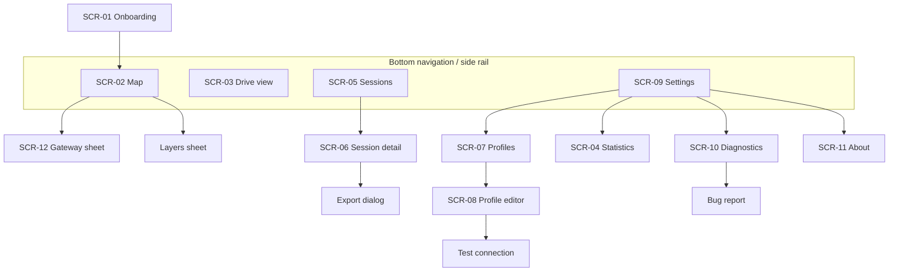
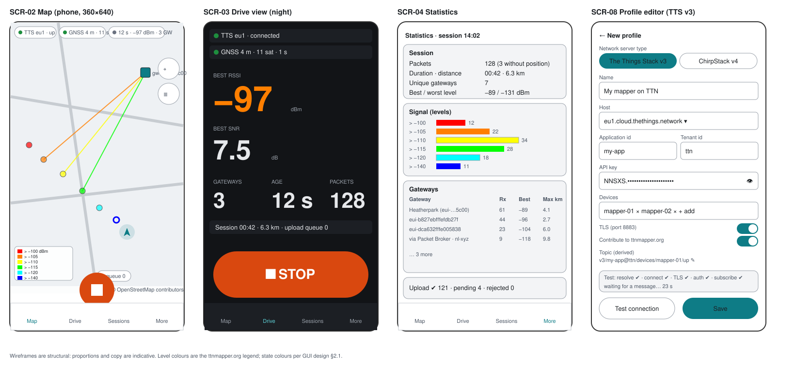
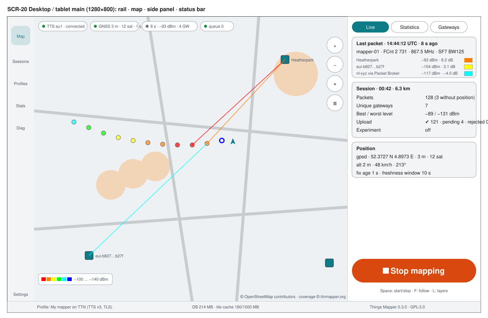
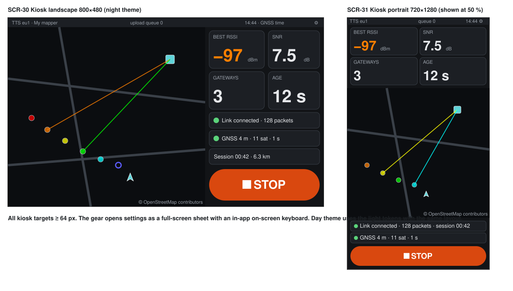
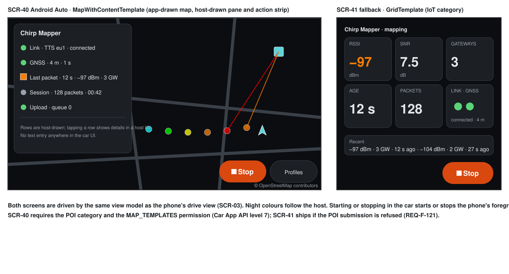

# 04 — GUI design

Status: **Draft**

| Rev | Date | Author | Change |
|---|---|---|---|
| 0.1 | 2026-09-11 | R. Welling (with Claude) | First complete version with wireframes |

Related: [02 Requirements](02-requirements.md) (REQ-P, REQ-NF-030…034),
[03 FDS](03-fds.md) (functions behind each screen), [05 TDS](05-tds.md)
(UI module), wireframes in [`gui/`](gui/).

---

## 1. Principles

1. **Map first, numbers second, everything else one tap away.** The map is
   the home screen on every platform; the indicators sit on top of it; the
   primary control is always visible.
2. **Glanceable.** Whether on a phone in a holder, a 7-inch screen behind
   the windscreen or a car display, the state must be readable in under a
   second: colour-coded chips, large numerals, strong contrast.
3. **One action.** *Start* / *Stop* is the only primary action. Nothing that
   requires typing is needed once a profile exists.
4. **Honest states.** Every indicator has an explicit *unknown / searching /
   ok / degraded / error* state; nothing pretends to be fine.
5. **Same mental model everywhere.** Identical vocabulary, colours, icons and
   screen names on all shells; only layout and input change.
6. **Safe by default.** Consent before upload, secrets masked, destructive
   actions confirmed, night theme when it is dark.

## 2. Design language

### 2.1 Colour tokens

| Token | Light | Dark / night | Use |
|---|---|---|---|
| `primary` | `#0E7C86` | `#5FD3D9` | brand, Start, active controls |
| `on-primary` | `#FFFFFF` | `#00363B` | text on primary |
| `stop` | `#D9480F` | `#FF9F6E` | Stop control, terminal errors |
| `surface` | `#FAFAFA` | `#121417` | backgrounds |
| `surface-2` | `#FFFFFF` | `#1C1F24` | cards, chips |
| `on-surface` | `#1B1F23` | `#E6E8EB` | text |
| `outline` | `#C7CCD1` | `#3A4048` | borders |
| `state-ok` | `#1E8E3E` | `#5BD37A` | connected, fix ok |
| `state-warn` | `#B26A00` | `#FFC24D` | reconnecting, poor accuracy, stale |
| `state-error` | `#B3261E` | `#FF7A70` | error, rejected |
| `state-off` | `#6B7280` | `#9AA1AA` | off, unknown |

Signal-level colours are fixed by the ttnmapper.org legend and are
**identical in both themes** (REQ-F-040): red `#FF0000` (> −100 dBm),
orange `#FF7F00`, yellow `#FFFF00`, green `#00FF00`, cyan `#00FFFF`, blue
`#0000FF` (> −140 dBm), black `#000000` (unknown). On the map they are drawn
at 60 % opacity with a 1 px `on-surface` outline so that yellow and cyan stay
visible on light tiles and blue on dark tiles. PB-only measurements are rings
(3 px stroke, no fill) in the same colour.

Android uses these as a fixed Material 3 colour scheme (no dynamic colour,
so that the level colours never clash with a user's wallpaper palette).

### 2.2 Typography

System sans-serif (Roboto on Android, the platform default elsewhere), tabular
figures for all numerals.

| Style | Size | Use |
|---|---|---|
| Display | 56–96 sp | drive-view numerals (RSSI, SNR, age) |
| Headline | 28 sp | kiosk tiles, section titles |
| Title | 20 sp | screen titles, card titles |
| Body | 16 sp (min 14) | text |
| Label | 12–14 sp | chips, units, attribution (never below 12) |

### 2.3 Spacing, shape, icons

8 dp grid; touch targets ≥ 48 dp (kiosk: ≥ 64 dp; car: template-defined);
corner radius 12 dp for cards, full for chips and the primary control. Icons:
Material Symbols (Apache-2.0). No third-party logos (REQ-C-006); network
types are indicated by text badges `TTS` and `CS4`.

### 2.4 Indicator chips

A chip has an icon, a short label and a state colour dot; tapping it opens
the detail (diagnostics or the relevant setting).

| Chip | Text examples | Colour |
|---|---|---|
| Link | `TTS eu1 · connected`, `reconnecting 3`, `error` | ok / warn / error / off |
| GNSS | `GNSS 4 m · 11 sat`, `GNSS 23 m`, `GNSS stale 14 s`, `searching` | ok / warn / warn / off |
| Last packet | `12 s · −97 dBm · 3 GW`, `PB only`, `— no packet` | neutral; warn when older than the alert threshold |
| Upload | `queue 0`, `sending 4`, `retry in 30 s`, `rejected 2`, `upload off` | ok / neutral / warn / error / off |

## 3. Information architecture and navigation

- **Phone (portrait):** bottom navigation with four destinations (Map,
  Drive, Sessions, More); the primary control floats above it.
- **Tablet / desktop:** navigation rail on the left, map in the centre, a
  persistent side panel with indicators and statistics on the right
  (`SCR-20`).
- **Raspberry Pi kiosk:** no navigation bar; the map plus an indicator
  column with the primary control (`SCR-30` landscape, `SCR-31` portrait);
  a settings gear opens the settings as a full-screen sheet.
- **Android Auto:** templates only (`SCR-40`, `SCR-41`); navigation is the
  host's.

## 4. Screen inventory

| ID | Screen | Purpose | Functions | Phone | Desktop/tablet | Kiosk | Car |
|---|---|---|---|---|---|---|---|
| SCR-01 | Onboarding | First run: purpose, data, consent, permissions, first profile | FDS-12.1 | ✔ | ✔ | ✔ (skipped by config file) | — |
| SCR-02 | Map | Home: map, chips, primary control, layer and re-centre controls | FDS-8, 9.1, 2.1 | ✔ | part of SCR-20 | part of SCR-30/31 | SCR-40 |
| SCR-03 | Drive view | Large indicators, primary control | FDS-9.3 | ✔ | ✔ | tiles in SCR-30/31 | pane in SCR-40 |
| SCR-04 | Statistics | Session statistics, per-gateway table | FDS-9.2 | ✔ | side panel tab | sheet | — |
| SCR-05 | Sessions | List, export, delete, select for map | FDS-6.2, 7 | ✔ | ✔ | sheet | — |
| SCR-06 | Session detail | Stats + map of one session + export | FDS-6.2, 7, 9.2 | ✔ | ✔ | sheet | — |
| SCR-07 | Profiles | List, active marker, import/export | FDS-1.1, 1.5, 1.6 | ✔ | ✔ | sheet | list template |
| SCR-08 | Profile editor | Type-specific form, TLS switch, test connection | FDS-1.2–1.4 | ✔ | ✔ | sheet + on-screen keyboard | — |
| SCR-09 | Settings | Catalogue of FDS-12.2 | FDS-12.2 | ✔ | ✔ | sheet | sound on/off only |
| SCR-10 | Diagnostics | Events, counters, bug report | FDS-13 | ✔ | ✔ | sheet | — |
| SCR-11 | About | Version, licence, notices, privacy | FDS-12.2 | ✔ | ✔ | sheet | — |
| SCR-12 | Gateway sheet | Details of a tapped gateway | FDS-8.5 | ✔ | ✔ | ✔ | — |
| SCR-13 | Alerts & dialogs | Banners, confirmations, errors | FDS-11, §6 FDS | ✔ | ✔ | ✔ | host alerts |
| SCR-20 | Desktop main | Map + rail + side panel | FDS-8, 9 | — | ✔ | — | — |
| SCR-30 | Kiosk landscape 800×480 | Map + indicator column + control | FDS-15.1 | — | — | ✔ | — |
| SCR-31 | Kiosk portrait 720×1280 | Tiles + map + control | FDS-15.1 | — | — | ✔ | — |
| SCR-40 | Car map | MapWithContentTemplate: app-drawn map + indicator pane + actions | FDS-14 | — | — | — | ✔ |
| SCR-41 | Car fallback | GridTemplate indicators + ListTemplate packets | FDS-14 | — | — | — | ✔ |

Wireframes: [gui/phone-screens.svg](gui/phone-screens.svg) (SCR-02, 03, 04,
08), [gui/desktop-main.svg](gui/desktop-main.svg) (SCR-20),
[gui/pi-kiosk.svg](gui/pi-kiosk.svg) (SCR-30, 31),
[gui/android-auto.svg](gui/android-auto.svg) (SCR-40, 41).

## 5. Screen specifications

### SCR-02 Map (phone)

| Element | Behaviour |
|---|---|
| Chip row (top, scrollable if narrow) | Link, GNSS, Last packet, Upload (§2.4); tap opens detail |
| Map | Layers of FDS-8.1; pinch/drag; long-press on a point shows its measurement summary; tap on a gateway opens SCR-12 |
| Re-centre control (right, upper) | Visible only when follow is off (FDS-8.4) |
| Layers control (right, below) | Sheet with base map, coverage overlay + opacity, lines, gateways, legend, earlier sessions |
| Legend (bottom-left, optional) | Six colour swatches with dBm labels; collapsible |
| Attribution (bottom, always) | Source attribution text; tap opens the source's page |
| Primary control (bottom centre, 72 dp) | `Start` (primary colour, play icon) ⇄ `Stop` (stop colour, stop icon); long-press on Stop shows session summary before stopping |
| Bottom navigation | Map · Drive · Sessions · More |
| Banner (below chips) | Alerts of FDS-11 and errors of FDS §6; dismissible when the condition has cleared |

States: *no profile* (map with an empty-state card "Add a profile to start
mapping" and a button), *idle*, *running*, *error* (banner in `stop`
colour).

### SCR-03 Drive view

Dark surface regardless of theme at night, light in daytime (auto). Grid of
numerals: best RSSI (dBm) and SNR (dB) of the last packet as the two largest
figures, gateway count, packet age (counting up every second), packets in
session, session duration, upload queue. Link and GNSS as full-width bars
with state colour. Primary control at the bottom, 96 dp on phones. No
map. Rotates with the device; in landscape the numerals form two rows.

### SCR-04 Statistics

Cards: *Session* (packets with/without position, duration, distance,
unique gateways), *Signal* (best/worst level, histogram of six classes as
horizontal bars in legend colours with counts), *Gateways* (table: id or
description, receptions, best level, max distance; tap → SCR-12), *Upload*
(done/pending/rejected/expired with retry/discard actions).

### SCR-05 / SCR-06 Sessions and session detail

List rows: start date-time (local), duration, profile badge, `n pts · m no
pos`, upload summary as a compact bar (done/pending/rejected). Swipe or
overflow: export, delete. Multi-select for export and *show on map*.
Detail: statistics cards plus a static map preview of the session's points
and an *Export* button (CSV, GeoJSON) and *Delete*.

### SCR-07 / SCR-08 Profiles and profile editor

Profiles list: name, type badge (`TTS`/`CS4`), host, device count, active
radio button, TLS lock icon (or an open-lock warning icon for acknowledged
plaintext). Editor (see wireframe): type selector at the top (disabled when
editing), then the type-specific fields of FDS-1.2/1.3; the secret field is
masked with a reveal toggle; the derived topic is shown read-only with an
*edit topic* expert switch; *Test connection* runs FDS-1.4 and shows a
stepper (resolve → connect → TLS → authenticate → subscribe → message) with
the failing step highlighted; *Save* is enabled once required fields
validate. Import/export/QR actions live in the list's overflow.

### SCR-09 Settings

Grouped list per FDS-12.2. Destructive items (reset installation id, clear
tile cache, delete all data) sit in a separate *Danger zone* group with
confirmation dialogs stating the consequence.

### SCR-10 Diagnostics

Counters as a compact grid; event list newest first with filter chips
(link, GNSS, upload, parse); *Export bug report* with a checkbox "include
last raw messages (redacted)"; the redaction is explained on the same
screen.

### SCR-12 Gateway sheet

Bottom sheet (phone), side card (desktop), overlay card (kiosk): id, EUI,
network, description, distance and bearing (with an arrow rotated relative to
heading), receptions this session, best level with colour swatch, first/last
seen, location source; *Show on map* centres the map on the gateway.

### SCR-20 Desktop / tablet main

Left rail (Map, Sessions, Profiles, Statistics, Diagnostics, Settings), map
in the centre with the same controls as SCR-02, right side panel (320–400 dp)
with three tabs: *Live* (chips as rows, last-packet card with all receptions
and their levels, primary control), *Statistics* (SCR-04 content),
*Gateways* (sortable table). A status bar at the bottom shows profile, tile
source attribution, database size and version. Keyboard: `Space` toggles
start/stop (with confirmation on stop), `F` follow, `L` layers, `+/-` zoom.

### SCR-30 / SCR-31 Raspberry Pi kiosk

Landscape 800×480: map on the left (≈ 500 px), a 300 px column on the right
with four tiles (RSSI, SNR, gateways, packet age) in headline size, a Link
row and a GNSS row with state colour, and the primary control (full width,
80 px). A 24 px status strip at the top shows profile, upload queue, clock
and a gear icon (opens settings as a full-screen sheet with an in-app
on-screen keyboard). Portrait 720×1280: tiles in two rows at the top, map in
the middle, Link/GNSS rows and the primary control at the bottom. All
targets ≥ 64 px. Night theme automatically between sunset and sunrise
(computed from the fix) or by setting.

### SCR-40 / SCR-41 Android Auto

SCR-40 `MapWithContentTemplate`: the app draws the map (follow mode always
on, no manual pan; host-provided zoom/pan gestures where the host allows
them) with points, lines and gateway markers; the content pane (host-drawn
list) shows rows *Link*, *GNSS*, *Last packet*, *Session*, *Upload* with
their state colour as row icon; the action strip offers *Start/Stop* and
*Profiles* (opens a `ListTemplate` of saved profiles, selection only). Night
mode and colours follow the host (`isDarkMode`). SCR-41 fallback (IoT
category): `GridTemplate` with six tiles (RSSI, SNR, gateways, age, packets,
link) and *Start/Stop* action; a second `ListTemplate` lists the last 10
packets ("−97 dBm · 3 GW · 12 s ago"). Both use the same view model as the
phone's drive view.

## 6. Onboarding (SCR-01)

Four full-screen steps with a progress indicator, per FDS-12.1:

1. **Welcome** — one paragraph, illustration of node + phone + gateway.
2. **Your data** — two columns: *stays on this device* (all measurements,
   sessions, profiles, secrets) and *sent to ttnmapper.org when you agree*
   (position, signal metadata, device and gateway ids, random installation
   id); link to the privacy page.
3. **Contribute?** — switch (default off until touched; the *Continue*
   button reads "Continue without uploading" while it is off), and the
   experiment option collapsed under *Advanced*.
4. **Permissions** — cards for precise location (why: to place measurements)
   and notifications (why: to show the mapping status while in background),
   each with a system-prompt button and a status.
5. **First profile** — SCR-08 embedded, with *Skip for now*.

## 7. Theming

Light and dark colour schemes from §2.1; *auto* follows the system on
Android and desktop, and sunset/sunrise on the kiosk. The map has its own
rendering mode (standard, greyscale, night) independent of the UI theme,
with *auto* mapping light→standard/greyscale (user choice) and dark→night.
Level colours never change (§2.1).

## 8. Accessibility

- Every control has a content description (Android) / accessible name
  (desktop); the primary control announces "Start mapping" / "Stop mapping,
  running for 42 minutes".
- Minimum contrast 4.5:1 for text and 3:1 for chips and icons in both
  themes; the state colours were chosen to pass against both surfaces.
- Colour is never the only cue: chips carry text; PB-only points differ in
  shape; the legend shows dBm values; alerts have icons.
- Text scales with the system font size up to 200 % on phone; the drive
  view and kiosk tiles use their own fixed scale.
- Focus order: chips → map controls → primary control → navigation.

## 9. Localisation

All strings externalised (REQ-F-102); English source, Dutch first
translation; ICU plurals for counts; units and number formats from the
locale; layouts tolerate +30 % text length (chips scroll horizontally, tiles
shrink the label before the number).

## 10. Empty, loading and error states

| Screen | Empty | Loading | Error |
|---|---|---|---|
| Map | "Add a profile to start mapping" card | tiles show a subtle grid while loading | banner with reason and action |
| Sessions | "No sessions yet — press Start on the map" | skeleton rows | "Could not read the database" with *export logs* |
| Statistics | "Statistics appear after the first packet" | spinner in card | — |
| Profile editor test | — | stepper animating | failing step in `state-error` with explanation |
| Diagnostics | "No events yet" | — | — |

## 11. Open points

| ID | Item |
|---|---|
| GUI-OP-1 | Final app icon and name lock-up (must not resemble the TTN Mapper icon). |
| GUI-OP-2 | Whether the kiosk on-screen keyboard is in-app (default) or delegated to an OS keyboard (`squeekboard`/`onboard`) when present. |
| GUI-OP-3 | Heading-up rotation on the phone map: on by default in follow mode or opt-in (motion sickness reports from other apps suggest opt-in). |
| GUI-OP-4 | Exact car pane rows allowed by the host's row limit (6 on most hosts) — currently 5. |
