# 07 — Implementation plan

Status: **Draft**

| Rev | Date | Author | Change |
|---|---|---|---|
| 0.1 | 2026-09-11 | R. Welling (with Claude) | First complete version |
| 0.2 | 2026-10-24 | R. Welling (with Claude) | Project renamed to Things Mapper; editions (ADR-0007): WP-2.16, WP-3.7, Paid-only Android Auto, release channels per edition, risks R-9…R-12 |
| 0.3 | 2026-10-24 | R. Welling (with Claude) | Sponsor catalogue is the only ad source (OP-7); licence route L-A (OP-8); no ad consent |
| 0.4 | 2026-10-24 | R. Welling (with Claude) | Free start screen; cost awareness and voluntary support (ADR-0008); budget per milestone |
| 0.5 | 2026-10-25 | R. Welling (with Claude) | Linux fixes in WP-2.11 and WP-3.1: `.deb` built in `debian:12` with install tests, kiosk unit started by the session, settings with atomic writes, provisioning-file precedence, secret-file owner/mode check |
| 0.6 | 2026-10-25 | R. Welling (with Claude) | ADR-0009: WP-2.1 sets up the library build `lib/` and the shell build `app/`, `lib.yml` with an iOS simulator job, `app.yml`; M2.1 exit adds TC-LB |
| 0.7 | 2026-10-25 | R. Welling (with Claude) | WP-2.1 also carries the early packaging check (bare desktop window as `.deb`, x86_64 and arm64, TC-PK-01/02) and the iOS skeleton of ADR-0010 (`app/ios-kit`, XcodeGen project, macOS CI job, TC-IO-01/02); WP-2.1 size L; WP-2.11, WP-3.1 and WP-4.1 build on them; risk R-15 |

Related: [02 Requirements](02-requirements.md), [05 TDS](05-tds.md)
(what is built), [06 Test plan](06-test-plan.md) (exit criteria per
milestone), [changelog](../changelog.md).

---

## 1. Approach

- **Core first, vertical slices second.** The platform-independent core with
  its tests and the replay tool come first, so that every later slice
  (desktop, phone, kiosk, car) is a thin shell over verified behaviour and
  can be demonstrated with replayed sessions before any hardware is
  involved.
- **Desktop before phone.** The desktop shell is the fastest feedback loop
  (no emulator, no signing) and is needed anyway for the Pi; the map
  renderer spike happens there.
- **Parity, then new ground.** Phase 2 ends with feature parity with TTN
  Mapper v3 on Android and desktop (TGT-01). Phase 3 adds what the original
  never had: the Pi kiosk and Android Auto.
- **Every platform from the first build.** WP-2.1 already packages a bare
  desktop window as `.deb` for x86_64 and arm64 and builds a skeleton iOS
  app in CI, so packaging problems show up in week one and phase 4 starts
  from a working Xcode project (ADR-0010).
- **Small releases.** Every milestone produces installable artefacts
  (GitHub pre-release); the Play internal track starts at M2.3.
- **AI-assisted, human-verified.** Development continues with Claude under
  the maintainer's supervision; the test plan, the review checklists and the
  field protocol are the verification, not the generator's confidence.

### Definition of done (per work package)
Code merged to `main` with green CI; tests of the package's test cases
implemented and passing; traceability matrix updated; documentation
(developer notes, user docs where applicable) updated; changelog entry;
no new High defects.

## 2. Phases and milestones

| Milestone | Content | Exit (test plan §11) | Artefacts |
|---|---|---|---|
| **Phase 1 — Design** (done with this repository state) | Evaluation, requirements, FDS, GUI, TDS, test plan, this plan, ADRs | design review checklist | `design/` |
| **M2.1 Foundation** | Repository/build/CI with the early packaging check and the iOS skeleton, core domain and ports, adapters with fixtures, pipeline, SQLDelight store and outbox, upload worker against stub, replay tool | U/I suites, TC-LB, TC-PK-01/02, TC-IO-01/02, coverage gate | `core`, `data`, `net` libraries (build `lib/`); `thingsmapper-replay`; CI artefacts: bare-window `.deb` (amd64, arm64), iOS simulator build |
| **M2.2 Desktop MVP** | Map renderer spike and go/no-go, desktop shell with map, indicators, session control, gpsd/NMEA/replay sources, profiles editor, TLS MQTT | TC-MA, TC-P-02/03 desktop, TC-PK-01 | `thingsmapper_0.1.0_amd64.deb` (pre-release) |
| **M2.3 Android MVP** | Android shell: onboarding, profiles, foreground service, map, drive view, upload with consent, secure store, diagnostics | TC-SE, TC-PR, TC-SO, TC-DS | APKs 0.2.0 (`freeFoss`, `paidFoss`), Play internal track for both editions |
| **M2.4 Parity release** | Sessions, exports (CSV/GeoJSON), statistics, alerts/sounds, legacy import, Dutch translation, editions and ad slot (WP-2.16), field tests, ingress coordination (OP-1) | TC-F-01/02/05, TC-ED, TGT-01/03 | 0.3.0 APK + deb; closed beta |
| **M3.1 Raspberry Pi kiosk** | Kiosk layouts, on-screen keyboard, provisioning file, systemd, arm64 packaging, Pi field test | TC-KI, TC-PK-02, TC-F-03, TGT-04 | `thingsmapper_0.4.0_arm64.deb`, Pi guide |
| **M3.2 Android Auto (Paid edition)** | Car App service, map template, profiles list, IoT fallback, DHU and head-unit tests, Play car review | TC-CA, TC-F-04, TGT-05 | Paid edition 0.5.0 with car support |
| **M3.3 Release 1.0** | Hardening, accessibility, Data Safety, licence report/SBOM, documentation, store publishing of both editions (WP-3.7), Play production, F-Droid submission (OP-9) | full regression on both editions, TC-ED, TGT-06 | 1.0.0 all channels |
| **Phase 4 (later)** | Apple investment decision (OP-11, doc 08), iOS shell with Free and Paid editions (Compose Multiplatform or SwiftUI on the core), generic MQTT/JSON adapter (TGT-08), multi-device sessions, AAOS packaging, status page | — | — |

## 3. Work packages

Effort is indicative, in person-weeks of focused work (maintainer with AI
assistance), and excludes waiting time for reviews, hardware or external
parties. Sizes: S ≈ 0.5–1 week, M ≈ 1–2, L ≈ 2–4.

### Phase 2

| WP | Title | Scope and deliverables | Depends on | Requirements | Size | Milestone |
|---|---|---|---|---|---|---|
| WP-2.1 | Repository and build | Two Gradle KTS builds per ADR-0009 — `lib/` with the library modules (targets `jvm`, `android` where an SDK is configured, `iosArm64`, `iosSimulatorArm64`) and `app/` with the shell modules, joined as a composite build (TDS §3); root wrapper, shared version catalogue and convention plugins, ktlint/detekt, ABI dumps, contract-suite scaffolding in `testing`, GitHub Actions `lib.yml` (Ubuntu and macOS iOS-simulator job) and `app.yml`, coverage gate, SPDX headers with the additional-permission line (license.md), PR checklist item "no upstream code copied", issue/PR templates, `lib/README.md` and `app/README.md`, `CLAUDE.md` for the code base; **early packaging check:** a bare `desktop` window with `--version`, `packageDeb` x86_64 and arm64 in the `debian:12` container with the install tests (`desktop.yml`, TDS-9.3); **iOS skeleton** per ADR-0010: `app/ios-kit`, XcodeGen project `app/ios/` with Free and Paid targets, `Local.xcconfig.example`, `app/ios/README.md`, macOS job in `app.yml`; TC-LB-01, 02, 04, TC-PK-01/02, TC-IO-01/02 | — | REQ-NF-042, REQ-NF-045, REQ-P-010, REQ-C-001, REQ-C-008 | L | M2.1 |
| WP-2.2 | Core domain, ports, rules | Domain model, value classes, ports, `Level`/`LevelClass`, gateway validation, normalisation, freshness, fix selection; unit tests TC-RU, TC-PO-01…03 | WP-2.1 | REQ-F-040…047, REQ-F-031…033 | M | M2.1 |
| WP-2.3 | Protocol adapters and fixtures | `TtsV3Adapter`, `ChirpStackV4Adapter`, Packet Broker rules, adapter registry, `ProfileFieldSpec`; fixtures FIX-TTS/CS4/CS3/BAD recorded and anonymised; TC-IN-01…08 | WP-2.2, NS-TTS/NS-CS4 access | REQ-F-020…024, REQ-F-008 | L | M2.1 |
| WP-2.4 | **Map renderer spike** | Projection, tile set, `DrawTarget`, tile cache, point/line/marker layers, Compose `MapView`; benchmark scene (20 k points/lines) on desktop and Pi 4; **go/no-go on ADR-0003** (fallback MapComposeMP) | WP-2.1 | REQ-F-060…064, REQ-NF-003 | L | M2.2 |
| WP-2.5 | Storage and outbox | SQLDelight schema, drivers, repositories, transactional `storeUplink`, outbox queries, migrations framework, settings store; TC-ST-01/02, TC-UP-04 | WP-2.2 | REQ-F-050, 056, REQ-NF-010, 013 | M | M2.1 |
| WP-2.6 | Pipeline and session controller | Bounded actor, dedupe (optional), fix attach, gateway registry, session state machine, diagnostics events/counters; TC-SE-01, TC-IN-15/16, TC-P-05 | WP-2.2, 2.5 | REQ-F-010, 012, 043…045, 110 | M | M2.1 |
| WP-2.7 | MQTT link | `MqttLink` on HiveMQ, TLS + custom CA, link state machine with backoff, connection test; Testcontainers Mosquitto; TC-IN-09…13, TC-PR-06 | WP-2.6 | REQ-F-004, 025, 027, REQ-NF-020 | M | M2.1 |
| WP-2.8 | Upload workers and payload | `IngressPayloadBuilder` with golden files (incl. equality with TTN Mapper v3 outputs), workers with retry schedule, custom endpoint, connectivity monitor, stub ingress for tests; TC-UP-01…08 | WP-2.5, 2.6 | REQ-F-080…088 | M | M2.1 |
| WP-2.9 | Replay tool | `record`, `publish`, `track`, `demo`; JSON-lines format; `ReplayLink`/`ReplayPositionSource`; TC-RT | WP-2.7 | REQ-F-140, 141 | S | M2.1 |
| WP-2.10 | UI foundation | Compose Multiplatform module: theme tokens, typography, navigation, adaptive scaffolds, resources/i18n infrastructure, chip components, view-model base; screenshot test harness | WP-2.1 | REQ-NF-030, 031, REQ-F-102 | M | M2.2 |
| WP-2.11 | Desktop shell | `main()`, window, DI wiring, provisioning file (TOML, precedence of FDS §3.7), settings store with atomic writes (TDS-5.3), gpsd and NMEA sources, XDG paths, logging with rotation, `--version`, the full application through the packaging pipeline of WP-2.1 (x86_64); screens: map, drive view, profiles/editor, settings (subset), diagnostics; TC-PO-05/06, TC-MA-06…08, TC-SO-06, TC-KI-09, TC-PK-01 | WP-2.4, 2.6…2.10 | REQ-P-003, REQ-F-030, 060…067, 070, 072, REQ-C-008 | L | M2.2 |
| WP-2.12 | Android shell | Application, `MainActivity`, `MappingService`, notification with Stop, permissions flow, `LocationManagerSource` + `GnssStatus`, secure store (Keystore), sounds, flavours `foss`/`play`, R8; screens: onboarding, map, drive, profiles/editor, settings, diagnostics; TC-SE-02…05, TC-PR-*, TC-SO-01/02, TC-DS-*; Play internal track | WP-2.10, 2.11 | REQ-P-001, 008, REQ-F-011, 014, 015, 090, 092, 100, 101, REQ-NF-021, 060 | L | M2.3 |
| WP-2.13 | Sessions, statistics, export/import | Sessions and session detail screens, statistics engine and screen, CSV/GeoJSON exporters (streamed), SAF/share on Android, legacy CSV import, retention warning; TC-ST-03…10, TC-IS-03/04 | WP-2.12 | REQ-F-051…055, 065, 071, 073 | M | M2.4 |
| WP-2.14 | Alerts, sounds, polish | Alert engine, packet sound picker, legend, gateway sheet, earlier sessions on map, keep-screen-on, Dutch translation, accessibility pass; TC-AL, TC-SO-03, TC-CX-01/02 | WP-2.13 | REQ-F-066, 090, 091, REQ-NF-033, 034 | M | M2.4 |
| WP-2.15 | Field validation and ingress coordination | OP-1 agreement (user agent, volumes), field tests TC-F-01/02/05/07 with protocol §7, fixes, parity checklist TGT-01/03, closed beta | WP-2.13, 2.14 | TGT-01…03, 07, REQ-C-002 | M (+ waiting) | M2.4 |
| WP-2.16 | Editions and ad slot | Build variants `free`/`paid` × `foss`/`play`, `Edition` constant, `ads` module with `AdPolicy`, `AdSlot`, `NoAdProvider`, `SponsorAdProvider` + catalogue signing script and `gh-pages` publication, upgrade entry, `EditionTransferProvider` and Paid import, CI manifest checks (no ad code in Paid, no car service in Free, no `AD_ID` anywhere); TC-ED-01…06, 08…11, 13, 14 | WP-2.12 | REQ-F-150…161 | M | M2.4 |
| WP-2.17 | Cost awareness and support | Funding file format, ledger and signing script (`tools/funding/`), `FundingRepository`; cost page (SCR-15); Free start screen (SCR-14) with `StartScreenPolicy`; yearly thank-you card (SCR-16) with `YearlyCardPolicy`; support (SCR-17): Play Billing provider in the `play` variants, GitHub Sponsors link in `foss` and desktop; *What's new* in About; release-notes template with the *Why this update* line and its CI check; TC-ED-15, TC-SU-01…04, 06…08 | WP-2.16 | REQ-F-162…167, REQ-C-011 | M | M2.4 |

### Phase 3

| WP | Title | Scope and deliverables | Depends on | Requirements | Size | Milestone |
|---|---|---|---|---|---|---|
| WP-3.1 | Kiosk shell | Kiosk scaffold for 800×480 and 720×1280, on-screen keyboard, long-press exit, provisioning file with secrets from file/env (owner/mode check), systemd user unit started from the session autostart, the full kiosk as arm64 `.deb` through the packaging pipeline of WP-2.1, software-rendering default decision, Pi guide in `documentation/` (autologin, labwc autostart lines, secret-file ownership); TC-KI-01…04, TC-KI-08, TC-PK-02 | WP-2.11, 2.15 | REQ-P-004, REQ-F-130, 131, 134, REQ-C-008 | L | M3.1 |
| WP-3.2 | Kiosk resilience and Pi field test | Connectivity toggling, cache behaviour, unsynced-clock flag, optional status page, 4 h drive test TC-F-03, performance TC-P-01/03 on Pi 4 (decide Pi 4 vs Pi 5 minimum, OP-6) | WP-3.1 | REQ-F-132, 133, 135, TGT-04 | M | M3.1 |
| WP-3.3 | Android Auto (Paid edition) | Car App service in the `paid` source set, `MapCarScreen` with `SurfaceCallback` renderer, profiles list, fallback grid/list behind build flag, host validator, DHU tests TC-CA-01…04/06, car location source; Play "Android Auto" review submission (OP-3) | WP-2.12, 2.4 | REQ-P-002, REQ-F-120…123 | L | M3.2 |
| WP-3.4 | Car field test and quality checklist | Real head unit test TC-F-04, checklist TC-CA-05, night mode, fixes | WP-3.3 | REQ-NF-032, TGT-05 | S | M3.2 |
| WP-3.5 | Hardening and compliance | Full regression, TC-CX, Data Safety form, privacy page, licence report and SBOM in release, reproducible `foss` build, crash-free monitoring without third-party SDK (Play vitals only), documentation set (`documentation/`) | WP-3.2, 3.4 | REQ-NF-023, 024, 044, 060…062, TGT-06 | M | M3.3 |
| WP-3.6 | Release 1.0 | Tag, signed artefacts, Play production rollout (staged), GitHub release, F-Droid metadata submission, announcement to the TTN Mapper community | WP-3.5 | — | S | M3.3 |
| WP-3.7 | Store publishing and compliance | Google Play payments profile, EU DSA trader declaration, two listings (Free, Paid) with a shared app-signing key, "contains ads" and Data Safety per edition, Android Auto review for the Paid app, Paid price €6 and edition names, supporter (€5/year) and tip (€2/€5/€10) products in both listings, GitHub Sponsors profile and `.github/FUNDING.yml`, sponsor catalogue go-live with the *Become a sponsor* page, first funding data publication; TC-ED-12, TC-SU-05, 09, 10 | WP-3.5 | REQ-C-010, REQ-NF-060, REQ-NF-064, TGT-09 | S | M3.3 |

### Phase 4 (not planned in detail)

| WP | Title | Note |
|---|---|---|
| WP-4.1 | iOS shell | Starts from the skeleton of ADR-0010 (`app/ios-kit`, XcodeGen project `app/ios/`, Free and Paid targets), which CI has built and tested since WP-2.1, and from libraries tested on the iOS simulator (ADR-0009); run TC-IO-03 on the first Mac; choose a Compose Multiplatform or a SwiftUI UI; decide how flows and `suspend` functions reach Swift (wrappers in `ios-kit` or Kotlin Swift export); needs Darwin HTTP engine, an MQTT implementation (CocoaMQTT via expect/actual or a pure-Kotlin client), Core Location source, `CoreGraphicsDrawTarget`; needs the Apple hardware of doc 08 (I-11…I-13) after the OP-11 decision; Free and Paid editions per REQ-P-009 (App Group import, sponsor ads from common code); App Store distribution of GPL software requires licence route OP-8 (ADR-0007 D5) |
| WP-4.2 | Generic MQTT/JSON adapter | Proves TGT-08 |
| WP-4.3 | Multi-device sessions and device colouring | REQ-F-005 extension |
| WP-4.4 | Android Automotive OS packaging | Same car module, AAOS target and Play AAOS review |

## 4. Sequencing

```mermaid
gantt
    title Things Mapper — indicative sequencing (weeks of focused effort, not calendar)
    dateFormat  X
    axisFormat  %s
    section M2.1 Foundation
    WP-2.1 Repo and build          :a1, 0, 3
    WP-2.2 Core domain and rules   :a2, after a1, 2
    WP-2.3 Adapters and fixtures   :a3, after a2, 3
    WP-2.5 Storage and outbox      :a5, after a2, 2
    WP-2.6 Pipeline and session    :a6, after a5, 2
    WP-2.7 MQTT link               :a7, after a6, 2
    WP-2.8 Upload workers          :a8, after a6, 2
    WP-2.9 Replay tool             :a9, after a7, 1
    section M2.2 Desktop MVP
    WP-2.4 Map renderer spike      :b4, after a1, 3
    WP-2.10 UI foundation          :b10, after a1, 2
    WP-2.11 Desktop shell          :b11, after a9, 3
    section M2.3 Android MVP
    WP-2.12 Android shell          :c12, after b11, 4
    section M2.4 Parity
    WP-2.13 Sessions, stats, export:d13, after c12, 2
    WP-2.14 Alerts and polish      :d14, after d13, 2
    WP-2.15 Field validation       :d15, after d14, 2
    WP-2.16 Editions and ad slot   :d16, after c12, 2
    WP-2.17 Costs and support      :d17, after d16, 2
    section Phase 3
    WP-3.1 Kiosk shell             :e1, after d15, 3
    WP-3.2 Kiosk field test        :e2, after e1, 2
    WP-3.3 Android Auto            :e3, after d15, 3
    WP-3.4 Car field test          :e4, after e3, 1
    WP-3.5 Hardening               :e5, after e2, 2
    WP-3.7 Store publishing        :e7, after e5, 1
    WP-3.6 Release 1.0             :e6, after e7, 1
```

Critical path: WP-2.1 → 2.2 → 2.5 → 2.6 → 2.7 → 2.9 → 2.11 → 2.12 → 2.13 →
2.14 → 2.15 → 3.1/3.3 → 3.5 → 3.6. The map spike (WP-2.4) runs in parallel
with the core packages and must conclude before WP-2.11 starts.

Indicative totals: phase 2 ≈ 37 person-weeks, phase 3 ≈ 16 person-weeks.
At a part-time pace these are calendar quarters, not weeks; the milestones
are ordered so that something usable exists from M2.2 onwards.

## 5. Ways of working

- **Repository:** `main` is always releasable; work happens on short-lived
  branches (`feat/…`, `fix/…`, `docs/…`) merged by pull request with green
  CI. Commits and pushes are performed by the maintainer (never by the
  assistant); the assistant prepares staged changes and commit messages.
  Conventional Commits.
- **Tracking:** GitHub Issues with milestones M2.1…M3.3 and labels
  `area:*`, `platform:*`, `type:*`; work packages become epics; requirement
  IDs are referenced in issues and PRs.
- **Reviews:** every PR is reviewed against the checklist of test plan §9;
  design changes update the relevant document in the same PR; lasting
  decisions get an ADR.
- **Documentation:** developer documentation lives with the code
  (`lib/README.md`, `app/README.md`, module READMEs, adapter guide); user documentation in
  `documentation/`; the changelog is updated per PR.
- **Quality gates:** ktlint, detekt, Android Lint (hard-coded text as
  error), coverage ≥ 80 % for `core`, licence check, dependency updates via
  Dependabot with grouped PRs.
- **Clean implementation:** the `ttnmapper-android-v3` submodule is read as
  a reference only; no code is copied from it into `app/` (REQ-C-009,
  ADR-0007 D5). Pull requests confirm this in the checklist.
- **Release notes and funding data:** every release carries a *Why this
  update* line (REQ-F-164); the funding data is refreshed at every release
  and at least quarterly (doc 08 §6).
- **Secrets and signing:** never in the repository; GitHub Actions secrets
  for release signing; local `signing.properties` ignored by git.

## 6. Release strategy

| Channel | From | Notes |
|---|---|---|
| GitHub Releases (pre-release) | M2.2 | `.deb` x86_64; `freeFoss` APK from M2.3 (OP-9); arm64 `.deb` from M3.1; checksums |
| Google Play internal testing | M2.3 | Free and Paid listings (`freePlay`, `paidPlay`); small tester list |
| Google Play closed beta | M2.4 | community testers from the TTN Mapper user base |
| Google Play production (staged) | M3.3 | Free and Paid listings; Android Auto in the Paid app after the WP-3.3 review |
| F-Droid | after 1.0 | `freeFoss` variant (sponsor ads, flagged "Ads"), reproducible build metadata — if OP-9 says yes |
| App Store (Free and Paid) | phase 4 | under additional permission (b) (license.md) |
| Debian package repository | later | until then GitHub Releases |

Versioning: 0.x pre-releases per milestone (0.1 M2.2, 0.2 M2.3, 0.3 M2.4,
0.4 M3.1, 0.5 M3.2), 1.0.0 at M3.3; SemVer thereafter.

## 7. Risks and mitigations (project level)

| ID | Risk | Likelihood / impact | Mitigation |
|---|---|---|---|
| R-1 | Map renderer spike fails performance on Pi 4 | M / M | Time-boxed spike (3 weeks); fallback MapComposeMP; Pi 5 minimum as last resort (OP-6) |
| R-2 | ttnmapper.org maintainer declines or delays acceptance of a new client (OP-1) | L / H | Contact early (start of M2.1); custom endpoint and local storage keep the app useful; respect rate limits |
| R-3 | Google Play rejects POI category (OP-3) | M / M | IoT fallback built in WP-3.3; personal use via developer mode |
| R-4 | Single maintainer bandwidth | H / M | Small milestones, each shippable; strict scope (MoSCoW); phase 4 parking lot |
| R-5 | Compose Multiplatform / KMP tooling churn | M / L | Pin versions per milestone; upgrade at milestone boundaries only |
| R-6 | Hardware availability (head unit, Pi displays, GNSS) | M / L | Order at phase 2 start; DHU covers most car testing |
| R-7 | Battery consumption on Android above target | M / M | Measure early (M2.3), tune keep-alive/GPS cadence; document expectation |
| R-8 | TTS or ChirpStack JSON changes | L / M | Lenient parsers; fixtures updated per release; version pinning of tested stacks in docs |
| R-9 | Upstream code copied into `app/` would fall outside the additional permission | L / H | Route L-A chosen 2026-10-24; rule REQ-C-009 in the contributing guide and PR checklist; review at every milestone |
| R-10 | Ad income negligible for a niche app | H / L | The Paid edition with Android Auto carries the cost coverage; sponsor catalogue with flat fees; costs are small (TGT-09) |
| R-11 | Store rejection over ad placement or the car category | M / M | Conservative placement (FDS-17.2), car only in the ad-free Paid app, IoT fallback (ADR-0004) |
| R-12 | The EU DSA trader declaration publishes the publisher's address and phone number | H / M | Decide the contact details before WP-3.7 (OP-10) |
| R-13 | Awareness measures perceived as nagging, hurting reviews | M / M | One start screen (Free only), at most one card a year, thank-you tone, no countdowns (ADR-0008 D7); watch reviews and adjust |
| R-14 | Hardware costs higher than estimated | M / L | Ranges in doc 08; refurbished hardware; Apple purchase gated by OP-11 |
| R-15 | The iOS skeleton decays before anybody in the project has a Mac | M / M | macOS CI job on every pull request (TC-IO-01/02); Xcode version selected explicitly; toolchain upgrades at milestone boundaries (R-5); README verified on the first Mac (TC-IO-03) |

## 8. Entry criteria for phase 2

1. Design review of documents 01–07 completed; comments resolved or logged.
2. Decisions confirmed: package root / application id (TDS-OP-1, done
   2026-10-24: `nl.pe1mew.thingsmapper`), app name and icon direction
   (GUI-OP-1).
3. OP-1 contact with the TTN Mapper maintainer initiated.
4. Test accounts and hardware: TTS Sandbox application and API key,
   ChirpStack v4 test instance, one mapping node, Raspberry Pi 4 with
   display and GNSS receiver ordered.
5. Repository settings: branch protection on `main`, Actions enabled,
   Dependabot enabled.
6. Clean-implementation rule (REQ-C-009) and the additional permission
   published in the contributing guide and license.md (done 2026-10-24).
7. Hardware for M2.1–M2.3 available (doc 08 I-1…I-4).

## 9. Budget and purchases

Money is spent per milestone, not up front; price ranges and assumptions
are in [08 Costs and funding](08-costs-and-funding.md).

| When | Purchases (doc 08 ids) | Estimate |
|---|---|---|
| M2.1 | I-4 LoRaWAN mapping node (if not owned) | €40–100 |
| M2.3 | I-1 Google Play registration, I-2 Android test phone, I-3 older Android phone | €373–573 |
| M3.1 | I-7…I-10 Raspberry Pi 5 kit, Touch Display 2, Raspberry Pi 4, GNSS receiver | €235–325 |
| M3.2 | I-5, I-6 Android Auto bench (head unit, 12 V supply, cables) | €200–450 |
| Phase 4, after OP-11 | I-11…I-13 Mac, iPhone, first year of the Apple Developer Program | €900–1,800 |
| Every year | R-1…R-8: Android only ≈ €95–155; with iOS ≈ €340–565 | — |

Hardware that is already owned enters the funding data at €0. The funding
data is first published in WP-3.7 (M3.3) and refreshed at every release and
at least quarterly.

